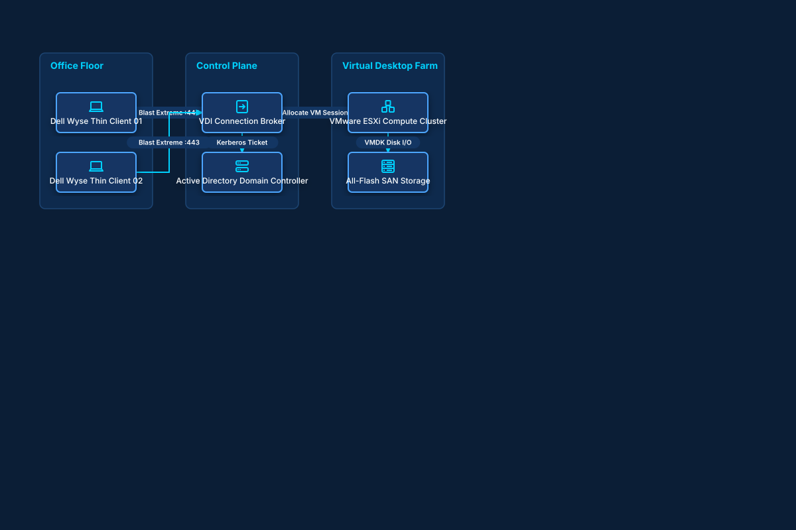

# Enterprise Virtual Desktop Infrastructure (VDI)

## Bill of Materials

| Symbol / ID | Label | Kind | Group | Technical Notes / Metadata |
| :--- | :--- | :--- | :--- | :--- |
| `thin1` | **Dell Wyse Thin Client 01** | box | Office Floor | os: ThinOS |
| `thin2` | **Dell Wyse Thin Client 02** | box | Office Floor | os: ThinOS |
| `broker` | **VDI Connection Broker** | box | Control Plane | auth: MFA RADIUS |
| `ad_dc` | **Active Directory Domain Controller** | box | Control Plane | domain: corp.internal |
| `esxi_cluster` | **VMware ESXi Compute Cluster** | box | Virtual Desktop Farm | hosts: 6x Dual Xeon Servers |
| `san_storage` | **All-Flash SAN Storage** | box | Virtual Desktop Farm | latency: 0.2ms IOPS |

## Connections

| Source | Target | Protocol / Label | Style | Routing |
| :--- | :--- | :--- | :--- | :--- |
| **Dell Wyse Thin Client 01** (`thin1`) | **VDI Connection Broker** (`broker`) | Blast Extreme :443 | solid | orthogonal |
| **Dell Wyse Thin Client 02** (`thin2`) | **VDI Connection Broker** (`broker`) | Blast Extreme :443 | solid | orthogonal |
| **VDI Connection Broker** (`broker`) | **Active Directory Domain Controller** (`ad_dc`) | Kerberos Ticket | dashed | orthogonal |
| **VDI Connection Broker** (`broker`) | **VMware ESXi Compute Cluster** (`esxi_cluster`) | Allocate VM Session | solid | orthogonal |
| **VMware ESXi Compute Cluster** (`esxi_cluster`) | **All-Flash SAN Storage** (`san_storage`) | VMDK Disk I/O | solid | orthogonal |
