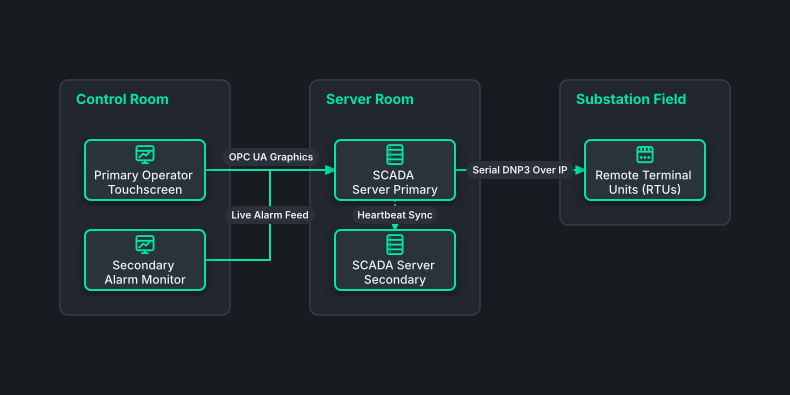

# SCADA Dual-Console Operator Control Station

## Bill of Materials

| Symbol / ID | Label | Kind | Group | Technical Notes / Metadata |
| :--- | :--- | :--- | :--- | :--- |
| `hmi_left` | **Primary Operator Touchscreen** | box | Control Room | display: 32-inch Industrial Touch |
| `hmi_right` | **Secondary Alarm Monitor** | box | Control Room | display: 32-inch High Contrast |
| `scada_pri` | **SCADA Server Primary** | box | Server Room | redundancy: Active Hot Standby |
| `scada_sec` | **SCADA Server Secondary** | box | Server Room | redundancy: Warm Standby |
| `field_rtu` | **Remote Terminal Units (RTUs)** | box | Substation Field | protocol: DNP3 / IEC 60870-5 |

## Connections

| Source | Target | Protocol / Label | Style | Routing |
| :--- | :--- | :--- | :--- | :--- |
| **Primary Operator Touchscreen** (`hmi_left`) | **SCADA Server Primary** (`scada_pri`) | OPC UA Graphics | solid | orthogonal |
| **Secondary Alarm Monitor** (`hmi_right`) | **SCADA Server Primary** (`scada_pri`) | Live Alarm Feed | solid | orthogonal |
| **SCADA Server Primary** (`scada_pri`) | **SCADA Server Secondary** (`scada_sec`) | Heartbeat Sync | dotted | orthogonal |
| **SCADA Server Primary** (`scada_pri`) | **Remote Terminal Units (RTUs)** (`field_rtu`) | Serial DNP3 Over IP | solid | orthogonal |
