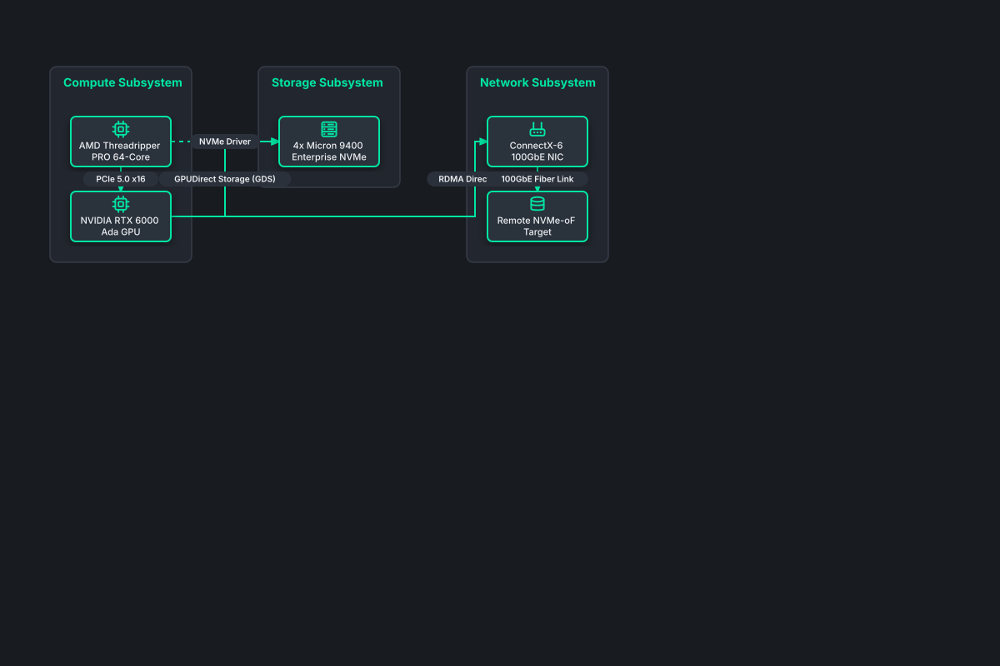

# High-Performance Compute Storage Pipeline

## Bill of Materials

| Symbol / ID | Label | Kind | Group | Technical Notes / Metadata |
| :--- | :--- | :--- | :--- | :--- |
| `cpu_host` | **AMD Threadripper PRO 64-Core** | box | Compute Subsystem | pcie: 128 Lanes PCIe Gen5 |
| `gpu_accel` | **NVIDIA RTX 6000 Ada GPU** | box | Compute Subsystem | vram: 48GB ECC GDDR6 |
| `nvme_raid` | **4x Micron 9400 Enterprise NVMe** | box | Storage Subsystem | bandwidth: 28 GB/s Read |
| `nic_100g` | **ConnectX-6 100GbE NIC** | box | Network Subsystem | protocol: RoCEv2 RDMA |
| `nvme_over_fabrics` | **Remote NVMe-oF Target** | box | Network Subsystem | latency: 15 microseconds |

## Connections

| Source | Target | Protocol / Label | Style | Routing |
| :--- | :--- | :--- | :--- | :--- |
| **AMD Threadripper PRO 64-Core** (`cpu_host`) | **NVIDIA RTX 6000 Ada GPU** (`gpu_accel`) | PCIe 5.0 x16 | solid | orthogonal |
| **NVIDIA RTX 6000 Ada GPU** (`gpu_accel`) | **4x Micron 9400 Enterprise NVMe** (`nvme_raid`) | GPUDirect Storage (GDS) | solid | orthogonal |
| **AMD Threadripper PRO 64-Core** (`cpu_host`) | **4x Micron 9400 Enterprise NVMe** (`nvme_raid`) | NVMe Driver | dashed | orthogonal |
| **NVIDIA RTX 6000 Ada GPU** (`gpu_accel`) | **ConnectX-6 100GbE NIC** (`nic_100g`) | RDMA Direct Pass | solid | orthogonal |
| **ConnectX-6 100GbE NIC** (`nic_100g`) | **Remote NVMe-oF Target** (`nvme_over_fabrics`) | 100GbE Fiber Link | solid | orthogonal |
