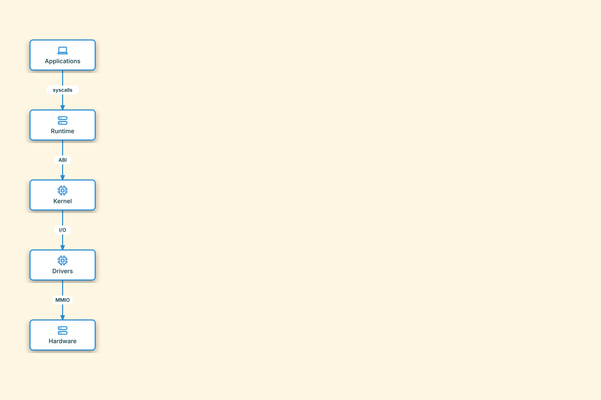

# Auto-Laid-Out Workstation Stack

## Bill of Materials

| Symbol / ID | Label | Kind | Group | Technical Notes / Metadata |
| :--- | :--- | :--- | :--- | :--- |
| `shape_1` | **Applications** | box | - | - |
| `shape_2` | **Runtime** | box | - | - |
| `shape_3` | **Kernel** | box | - | - |
| `shape_4` | **Drivers** | box | - | - |
| `shape_5` | **Hardware** | box | - | - |

## Connections

| Source | Target | Protocol / Label | Style | Routing |
| :--- | :--- | :--- | :--- | :--- |
| **Applications** (`shape_1`) | **Runtime** (`shape_2`) | syscalls | solid | orthogonal |
| **Runtime** (`shape_2`) | **Kernel** (`shape_3`) | ABI | solid | orthogonal |
| **Kernel** (`shape_3`) | **Drivers** (`shape_4`) | I/O | solid | orthogonal |
| **Drivers** (`shape_4`) | **Hardware** (`shape_5`) | MMIO | solid | orthogonal |
