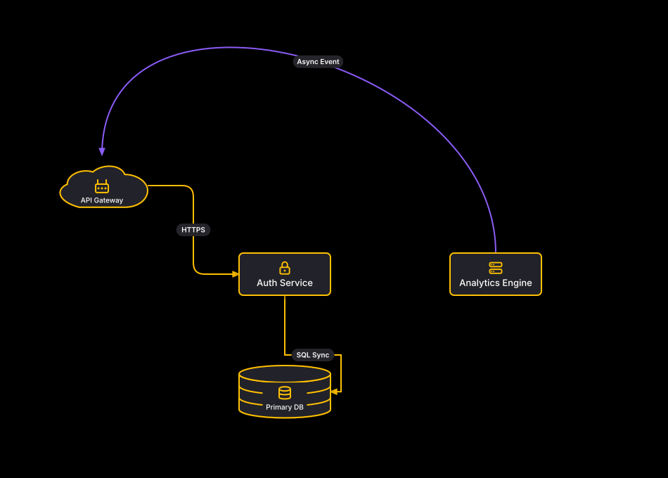

# Architecture Overview: Curves & Fillets

## Bill of Materials

| Symbol / ID | Label | Kind | Group | Technical Notes / Metadata |
| :--- | :--- | :--- | :--- | :--- |
| `shape_1` | **API Gateway** | cloud | - | - |
| `shape_2` | **Auth Service** | cybersecurity | - | - |
| `shape_3` | **Analytics Engine** | ai | - | - |
| `shape_4` | **Primary DB** | database | - | - |

## Connections

| Source | Target | Protocol / Label | Style | Routing |
| :--- | :--- | :--- | :--- | :--- |
| **API Gateway** (`shape_1`) | **Auth Service** (`shape_2`) | HTTPS | solid | orthogonal |
| **Analytics Engine** (`shape_3`) | **API Gateway** (`shape_1`) | Async Event | solid | curve |
| **Auth Service** (`shape_2`) | **Primary DB** (`shape_4`) | SQL Sync | solid | orthogonal |
