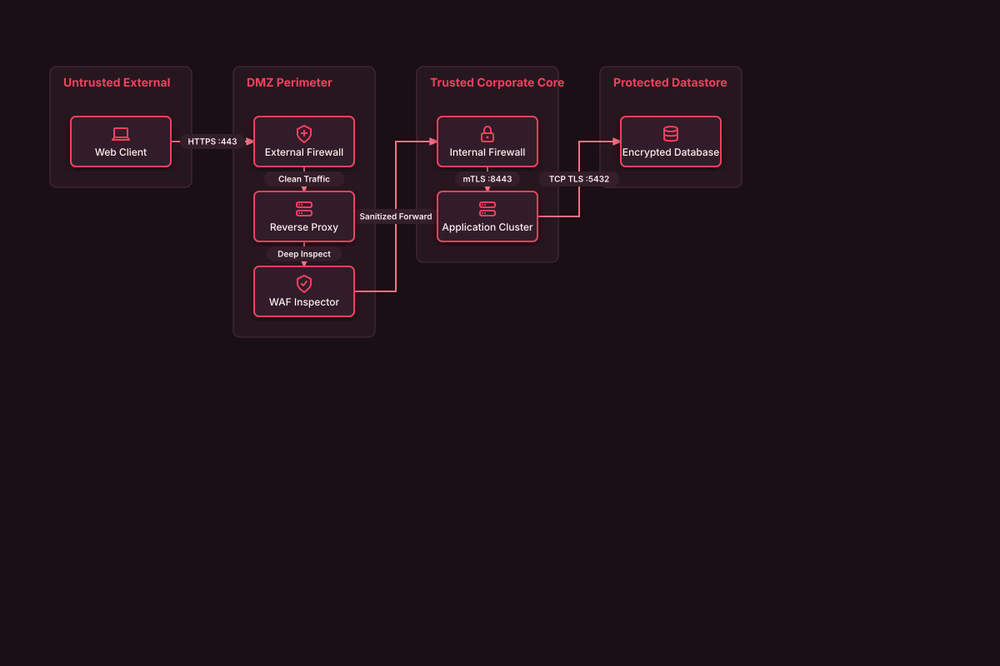

# Enterprise DMZ Perimeter Defense

## Bill of Materials

| Symbol / ID | Label | Kind | Group | Technical Notes / Metadata |
| :--- | :--- | :--- | :--- | :--- |
| `client` | **Web Client** | box | Untrusted External | origin: Internet |
| `ext_fw` | **External Firewall** | box | DMZ Perimeter | policy: Drop Default |
| `proxy` | **Reverse Proxy** | box | DMZ Perimeter | port: 443/TLS |
| `waf` | **WAF Inspector** | box | DMZ Perimeter | rules: OWASP Core |
| `int_fw` | **Internal Firewall** | box | Trusted Corporate Core | policy: Strict mTLS |
| `app` | **Application Cluster** | box | Trusted Corporate Core | env: Production |
| `db` | **Encrypted Database** | box | Protected Datastore | data: AES-256 at Rest |

## Connections

| Source | Target | Protocol / Label | Style | Routing |
| :--- | :--- | :--- | :--- | :--- |
| **Web Client** (`client`) | **External Firewall** (`ext_fw`) | HTTPS :443 | solid | orthogonal |
| **External Firewall** (`ext_fw`) | **Reverse Proxy** (`proxy`) | Clean Traffic | solid | orthogonal |
| **Reverse Proxy** (`proxy`) | **WAF Inspector** (`waf`) | Deep Inspect | solid | orthogonal |
| **WAF Inspector** (`waf`) | **Internal Firewall** (`int_fw`) | Sanitized Forward | solid | orthogonal |
| **Internal Firewall** (`int_fw`) | **Application Cluster** (`app`) | mTLS :8443 | solid | orthogonal |
| **Application Cluster** (`app`) | **Encrypted Database** (`db`) | TCP TLS :5432 | solid | orthogonal |
