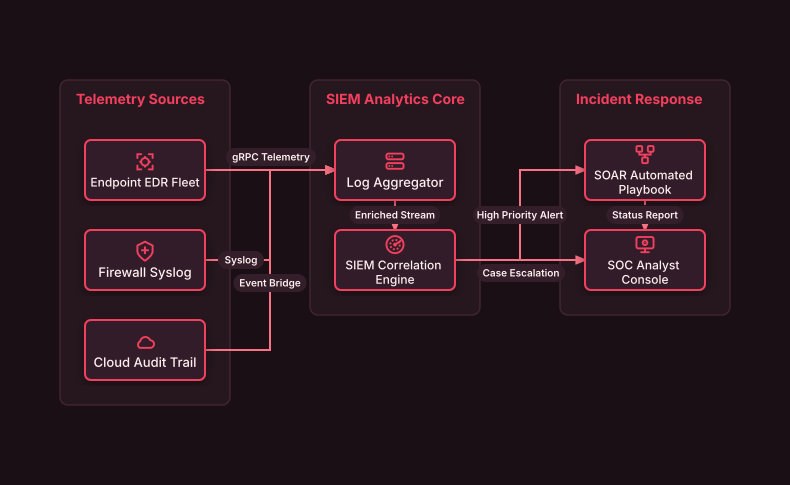

# SOC & SIEM Telemetry Analytics Pipeline

## Bill of Materials

| Symbol / ID | Label | Kind | Group | Technical Notes / Metadata |
| :--- | :--- | :--- | :--- | :--- |
| `edr` | **Endpoint EDR Fleet** | box | Telemetry Sources | agents: 5000 Nodes |
| `net_fw` | **Firewall Syslog** | box | Telemetry Sources | protocol: Syslog/TLS |
| `cloud_trail` | **Cloud Audit Trail** | box | Telemetry Sources | source: API Events |
| `aggregator` | **Log Aggregator** | box | SIEM Analytics Core | throughput: 100k EPS |
| `siem` | **SIEM Correlation Engine** | box | SIEM Analytics Core | engine: Realtime ML |
| `soar` | **SOAR Automated Playbook** | box | Incident Response | action: Auto-Containment |
| `soc` | **SOC Analyst Console** | box | Incident Response | tier: Tier 2 SOC |

## Connections

| Source | Target | Protocol / Label | Style | Routing |
| :--- | :--- | :--- | :--- | :--- |
| **Endpoint EDR Fleet** (`edr`) | **Log Aggregator** (`aggregator`) | gRPC Telemetry | solid | orthogonal |
| **Firewall Syslog** (`net_fw`) | **Log Aggregator** (`aggregator`) | Syslog | solid | orthogonal |
| **Cloud Audit Trail** (`cloud_trail`) | **Log Aggregator** (`aggregator`) | Event Bridge | solid | orthogonal |
| **Log Aggregator** (`aggregator`) | **SIEM Correlation Engine** (`siem`) | Enriched Stream | solid | orthogonal |
| **SIEM Correlation Engine** (`siem`) | **SOAR Automated Playbook** (`soar`) | High Priority Alert | solid | orthogonal |
| **SIEM Correlation Engine** (`siem`) | **SOC Analyst Console** (`soc`) | Case Escalation | solid | orthogonal |
| **SOAR Automated Playbook** (`soar`) | **SOC Analyst Console** (`soc`) | Status Report | dashed | orthogonal |
