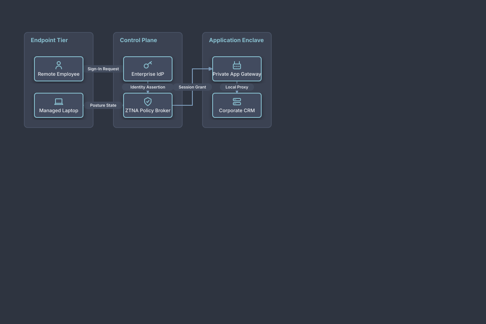

# Zero Trust Network Access (ZTNA) Architecture

## Bill of Materials

| Symbol / ID | Label | Kind | Group | Technical Notes / Metadata |
| :--- | :--- | :--- | :--- | :--- |
| `employee` | **Remote Employee** | box | Endpoint Tier | auth: MFA Challenge |
| `device` | **Managed Laptop** | box | Endpoint Tier | posture: EDR Healthy |
| `idp` | **Enterprise IdP** | box | Control Plane | protocol: OIDC / FIDO2 |
| `ztna_broker` | **ZTNA Policy Broker** | box | Control Plane | eval: Continuous Trust |
| `app_gw` | **Private App Gateway** | box | Application Enclave | tunnel: WireGuard |
| `corp_crm` | **Corporate CRM** | box | Application Enclave | access: Microsegmented |

## Connections

| Source | Target | Protocol / Label | Style | Routing |
| :--- | :--- | :--- | :--- | :--- |
| **Remote Employee** (`employee`) | **Enterprise IdP** (`idp`) | Sign-In Request | solid | orthogonal |
| **Managed Laptop** (`device`) | **ZTNA Policy Broker** (`ztna_broker`) | Posture State | solid | orthogonal |
| **Enterprise IdP** (`idp`) | **ZTNA Policy Broker** (`ztna_broker`) | Identity Assertion | solid | orthogonal |
| **ZTNA Policy Broker** (`ztna_broker`) | **Private App Gateway** (`app_gw`) | Session Grant | solid | orthogonal |
| **Private App Gateway** (`app_gw`) | **Corporate CRM** (`corp_crm`) | Local Proxy | solid | orthogonal |
