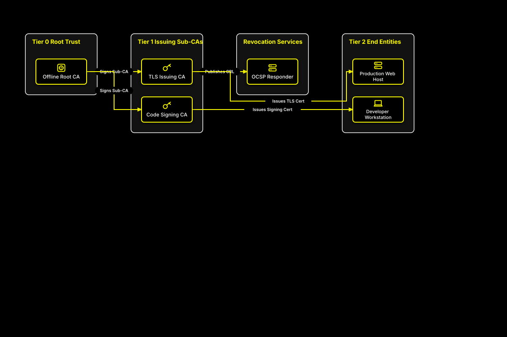

# Public Key Infrastructure (PKI) Certificate Hierarchy

## Bill of Materials

| Symbol / ID | Label | Kind | Group | Technical Notes / Metadata |
| :--- | :--- | :--- | :--- | :--- |
| `root_ca` | **Offline Root CA** | box | Tier 0 Root Trust | key: RSA 4096 / HSM, state: Air-Gapped |
| `tls_ca` | **TLS Issuing CA** | box | Tier 1 Issuing Sub-CAs | validity: 3 Years |
| `code_ca` | **Code Signing CA** | box | Tier 1 Issuing Sub-CAs | validity: 2 Years |
| `ocsp` | **OCSP Responder** | box | Revocation Services | protocol: OCSP / RFC 6960 |
| `web_svr` | **Production Web Host** | box | Tier 2 End Entities | cert: Leaf TLS |
| `dev_ws` | **Developer Workstation** | box | Tier 2 End Entities | cert: Developer Identity |

## Connections

| Source | Target | Protocol / Label | Style | Routing |
| :--- | :--- | :--- | :--- | :--- |
| **Offline Root CA** (`root_ca`) | **TLS Issuing CA** (`tls_ca`) | Signs Sub-CA | solid | orthogonal |
| **Offline Root CA** (`root_ca`) | **Code Signing CA** (`code_ca`) | Signs Sub-CA | solid | orthogonal |
| **TLS Issuing CA** (`tls_ca`) | **OCSP Responder** (`ocsp`) | Publishes CRL | solid | orthogonal |
| **TLS Issuing CA** (`tls_ca`) | **Production Web Host** (`web_svr`) | Issues TLS Cert | solid | orthogonal |
| **Code Signing CA** (`code_ca`) | **Developer Workstation** (`dev_ws`) | Issues Signing Cert | solid | orthogonal |
