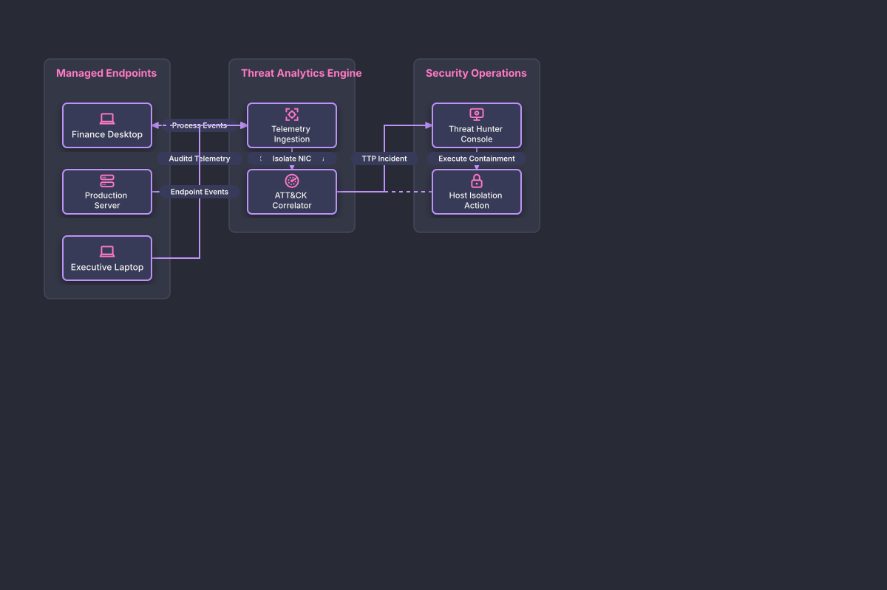

# Endpoint Detection & Threat Hunting Grid

## Bill of Materials

| Symbol / ID | Label | Kind | Group | Technical Notes / Metadata |
| :--- | :--- | :--- | :--- | :--- |
| `win_host` | **Finance Desktop** | box | Managed Endpoints | os: Windows 11 |
| `linux_srv` | **Production Server** | box | Managed Endpoints | os: RHEL 9 |
| `mac_host` | **Executive Laptop** | box | Managed Endpoints | os: macOS Sonoma |
| `sensor_hub` | **Telemetry Ingestion** | box | Threat Analytics Engine | protocol: gRPC Streaming |
| `mitre_engine` | **ATT&CK Correlator** | box | Threat Analytics Engine | rules: Behavioral Heuristics |
| `analyst_ws` | **Threat Hunter Console** | box | Security Operations | role: Lead Investigator |
| `quarantine` | **Host Isolation Action** | box | Security Operations | status: Isolated at NIC |

## Connections

| Source | Target | Protocol / Label | Style | Routing |
| :--- | :--- | :--- | :--- | :--- |
| **Finance Desktop** (`win_host`) | **Telemetry Ingestion** (`sensor_hub`) | Process Events | solid | orthogonal |
| **Production Server** (`linux_srv`) | **Telemetry Ingestion** (`sensor_hub`) | Auditd Telemetry | solid | orthogonal |
| **Executive Laptop** (`mac_host`) | **Telemetry Ingestion** (`sensor_hub`) | Endpoint Events | solid | orthogonal |
| **Telemetry Ingestion** (`sensor_hub`) | **ATT&CK Correlator** (`mitre_engine`) | Structured Events | solid | orthogonal |
| **ATT&CK Correlator** (`mitre_engine`) | **Threat Hunter Console** (`analyst_ws`) | TTP Incident | solid | orthogonal |
| **Threat Hunter Console** (`analyst_ws`) | **Host Isolation Action** (`quarantine`) | Execute Containment | solid | orthogonal |
| **Host Isolation Action** (`quarantine`) | **Finance Desktop** (`win_host`) | Isolate NIC | dashed | orthogonal |
