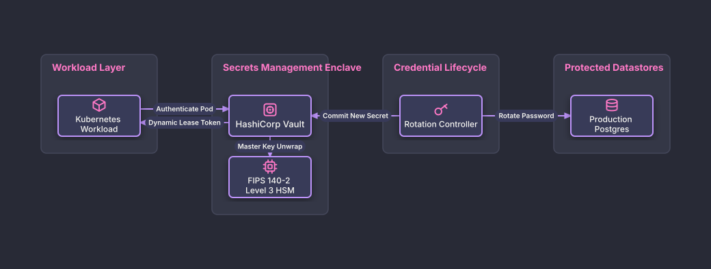

# Automated Secrets Vault & Credential Rotation

## Bill of Materials

| Symbol / ID | Label | Kind | Group | Technical Notes / Metadata |
| :--- | :--- | :--- | :--- | :--- |
| `k8s_app` | **Kubernetes Workload** | box | Workload Layer | identity: SPIFFE / JWT |
| `vault_srv` | **HashiCorp Vault** | box | Secrets Management Enclave | storage: Integrated Raft |
| `hsm` | **FIPS 140-2 Level 3 HSM** | box | Secrets Management Enclave | function: Root Key Auto-Unwrap |
| `rotator` | **Rotation Controller** | box | Credential Lifecycle | cron: Every 24 Hours |
| `prod_db` | **Production Postgres** | box | Protected Datastores | ssl: Enforced TLS 1.3 |

## Connections

| Source | Target | Protocol / Label | Style | Routing |
| :--- | :--- | :--- | :--- | :--- |
| **Kubernetes Workload** (`k8s_app`) | **HashiCorp Vault** (`vault_srv`) | Authenticate Pod | solid | orthogonal |
| **HashiCorp Vault** (`vault_srv`) | **FIPS 140-2 Level 3 HSM** (`hsm`) | Master Key Unwrap | solid | orthogonal |
| **HashiCorp Vault** (`vault_srv`) | **Kubernetes Workload** (`k8s_app`) | Dynamic Lease Token | solid | orthogonal |
| **Rotation Controller** (`rotator`) | **Production Postgres** (`prod_db`) | Rotate Password | solid | orthogonal |
| **Rotation Controller** (`rotator`) | **HashiCorp Vault** (`vault_srv`) | Commit New Secret | solid | orthogonal |
