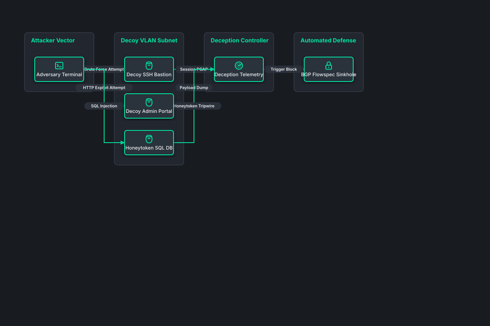

# Deception Technology Honeynet Grid

## Bill of Materials

| Symbol / ID | Label | Kind | Group | Technical Notes / Metadata |
| :--- | :--- | :--- | :--- | :--- |
| `adversary` | **Adversary Terminal** | box | Attacker Vector | origin: Compromised Node |
| `decoy_ssh` | **Decoy SSH Bastion** | box | Decoy VLAN Subnet | service: OpenSSH 8.2 Decoy |
| `decoy_web` | **Decoy Admin Portal** | box | Decoy VLAN Subnet | service: Fake Jenkins UI |
| `decoy_db` | **Honeytoken SQL DB** | box | Decoy VLAN Subnet | data: Canary Records |
| `honey_siem` | **Deception Telemetry** | box | Deception Controller | analysis: Session Recording |
| `blackhole` | **BGP Flowspec Sinkhole** | box | Automated Defense | action: Null-Route IP |

## Connections

| Source | Target | Protocol / Label | Style | Routing |
| :--- | :--- | :--- | :--- | :--- |
| **Adversary Terminal** (`adversary`) | **Decoy SSH Bastion** (`decoy_ssh`) | Brute Force Attempt | solid | orthogonal |
| **Adversary Terminal** (`adversary`) | **Decoy Admin Portal** (`decoy_web`) | HTTP Exploit Attempt | solid | orthogonal |
| **Adversary Terminal** (`adversary`) | **Honeytoken SQL DB** (`decoy_db`) | SQL Injection | solid | orthogonal |
| **Decoy SSH Bastion** (`decoy_ssh`) | **Deception Telemetry** (`honey_siem`) | Session PCAP | solid | orthogonal |
| **Decoy Admin Portal** (`decoy_web`) | **Deception Telemetry** (`honey_siem`) | Payload Dump | solid | orthogonal |
| **Honeytoken SQL DB** (`decoy_db`) | **Deception Telemetry** (`honey_siem`) | Honeytoken Tripwire | solid | orthogonal |
| **Deception Telemetry** (`honey_siem`) | **BGP Flowspec Sinkhole** (`blackhole`) | Trigger Block | solid | orthogonal |
