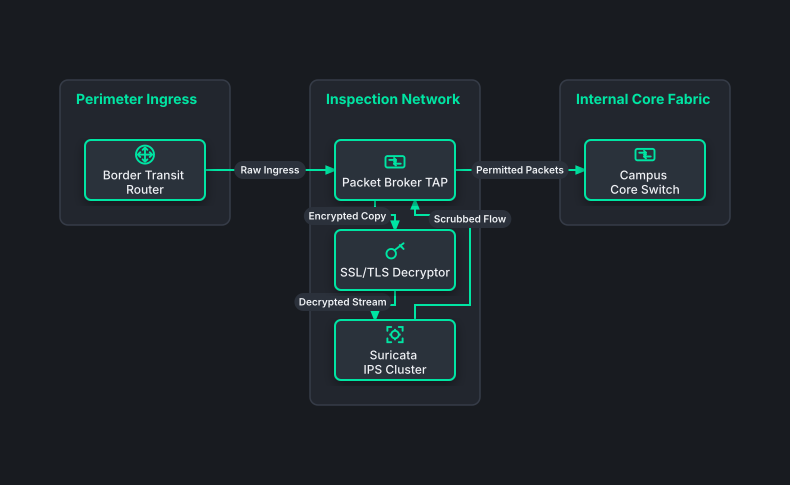

# Inline IDS/IPS Deep Packet Inspection

## Bill of Materials

| Symbol / ID | Label | Kind | Group | Technical Notes / Metadata |
| :--- | :--- | :--- | :--- | :--- |
| `border_rtr` | **Border Transit Router** | box | Perimeter Ingress | bandwidth: 100 Gbps |
| `npb` | **Packet Broker TAP** | box | Inspection Network | mode: Hardware Bypass |
| `decryptor` | **SSL/TLS Decryptor** | box | Inspection Network | hardware: ASIC Accelerator |
| `suricata_ips` | **Suricata IPS Cluster** | box | Inspection Network | engine: Inline Drop Mode |
| `core_sw` | **Campus Core Switch** | box | Internal Core Fabric | segment: Clean Corporate LAN |

## Connections

| Source | Target | Protocol / Label | Style | Routing |
| :--- | :--- | :--- | :--- | :--- |
| **Border Transit Router** (`border_rtr`) | **Packet Broker TAP** (`npb`) | Raw Ingress | solid | orthogonal |
| **Packet Broker TAP** (`npb`) | **SSL/TLS Decryptor** (`decryptor`) | Encrypted Copy | solid | orthogonal |
| **SSL/TLS Decryptor** (`decryptor`) | **Suricata IPS Cluster** (`suricata_ips`) | Decrypted Stream | solid | orthogonal |
| **Suricata IPS Cluster** (`suricata_ips`) | **Packet Broker TAP** (`npb`) | Scrubbed Flow | solid | orthogonal |
| **Packet Broker TAP** (`npb`) | **Campus Core Switch** (`core_sw`) | Permitted Packets | solid | orthogonal |
