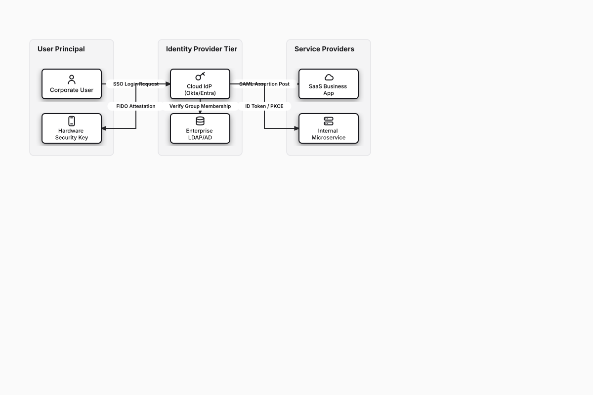

# Enterprise IAM Federation & SSO Pipeline

## Bill of Materials

| Symbol / ID | Label | Kind | Group | Technical Notes / Metadata |
| :--- | :--- | :--- | :--- | :--- |
| `user_node` | **Corporate User** | box | User Principal | browser: Chrome / Edge |
| `fido_mfa` | **Hardware Security Key** | box | User Principal | standard: FIDO2 / WebAuthn |
| `idp_cloud` | **Cloud IdP (Okta/Entra)** | box | Identity Provider Tier | standards: SAML 2.0 & OIDC |
| `directory` | **Enterprise LDAP/AD** | box | Identity Provider Tier | sync: SCIM Provisioning |
| `saas_app` | **SaaS Business App** | box | Service Providers | auth: SAML Assertion |
| `portal_app` | **Internal Microservice** | box | Service Providers | auth: OAuth2 / OIDC JWT |

## Connections

| Source | Target | Protocol / Label | Style | Routing |
| :--- | :--- | :--- | :--- | :--- |
| **Corporate User** (`user_node`) | **Cloud IdP (Okta/Entra)** (`idp_cloud`) | SSO Login Request | solid | orthogonal |
| **Cloud IdP (Okta/Entra)** (`idp_cloud`) | **Hardware Security Key** (`fido_mfa`) | Challenge MFA | solid | orthogonal |
| **Hardware Security Key** (`fido_mfa`) | **Cloud IdP (Okta/Entra)** (`idp_cloud`) | FIDO Attestation | solid | orthogonal |
| **Cloud IdP (Okta/Entra)** (`idp_cloud`) | **Enterprise LDAP/AD** (`directory`) | Verify Group Membership | solid | orthogonal |
| **Cloud IdP (Okta/Entra)** (`idp_cloud`) | **SaaS Business App** (`saas_app`) | SAML Assertion Post | solid | orthogonal |
| **Cloud IdP (Okta/Entra)** (`idp_cloud`) | **Internal Microservice** (`portal_app`) | ID Token / PKCE | solid | orthogonal |
