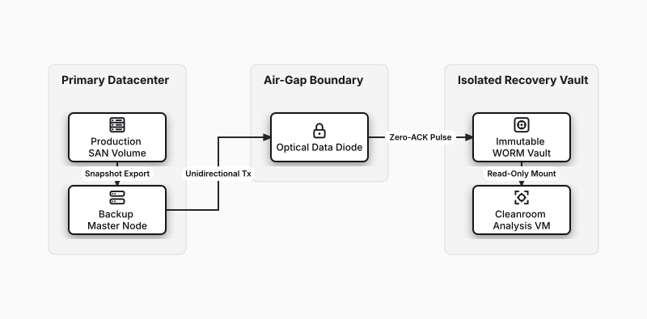

# Ransomware Defense & Optical Air-Gapped Vault

## Bill of Materials

| Symbol / ID | Label | Kind | Group | Technical Notes / Metadata |
| :--- | :--- | :--- | :--- | :--- |
| `prod_san` | **Production SAN Volume** | box | Primary Datacenter | storage: NVMe-oF |
| `backup_mgr` | **Backup Master Node** | box | Primary Datacenter | job: Continuous Snapshot |
| `diode` | **Optical Data Diode** | box | Air-Gap Boundary | physics: Transmit Only (Tx) |
| `immutable_vault` | **Immutable WORM Vault** | box | Isolated Recovery Vault | retention: Object Lock Hardened |
| `clean_vm` | **Cleanroom Analysis VM** | box | Isolated Recovery Vault | scan: YARA Malware Heuristics |

## Connections

| Source | Target | Protocol / Label | Style | Routing |
| :--- | :--- | :--- | :--- | :--- |
| **Production SAN Volume** (`prod_san`) | **Backup Master Node** (`backup_mgr`) | Snapshot Export | solid | orthogonal |
| **Backup Master Node** (`backup_mgr`) | **Optical Data Diode** (`diode`) | Unidirectional Tx | solid | orthogonal |
| **Optical Data Diode** (`diode`) | **Immutable WORM Vault** (`immutable_vault`) | Zero-ACK Pulse | solid | orthogonal |
| **Immutable WORM Vault** (`immutable_vault`) | **Cleanroom Analysis VM** (`clean_vm`) | Read-Only Mount | solid | orthogonal |
