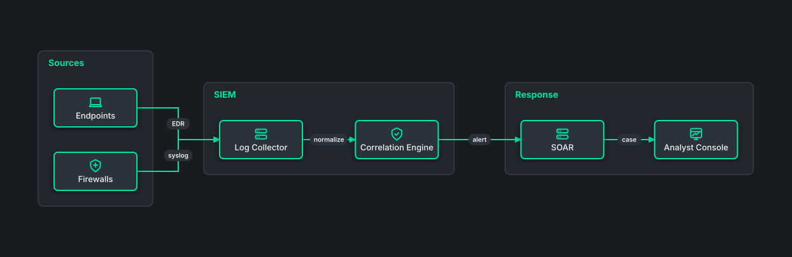

# Auto-Laid-Out SOC Detection Pipeline

## Bill of Materials

| Symbol / ID | Label | Kind | Group | Technical Notes / Metadata |
| :--- | :--- | :--- | :--- | :--- |
| `shape_2` | **Endpoints** | box | Sources | - |
| `shape_3` | **Firewalls** | box | Sources | - |
| `shape_5` | **Log Collector** | box | SIEM | - |
| `shape_6` | **Correlation Engine** | box | SIEM | - |
| `shape_8` | **SOAR** | box | Response | - |
| `shape_9` | **Analyst Console** | box | Response | - |

## Connections

| Source | Target | Protocol / Label | Style | Routing |
| :--- | :--- | :--- | :--- | :--- |
| **Endpoints** (`shape_2`) | **Log Collector** (`shape_5`) | EDR | solid | orthogonal |
| **Firewalls** (`shape_3`) | **Log Collector** (`shape_5`) | syslog | solid | orthogonal |
| **Log Collector** (`shape_5`) | **Correlation Engine** (`shape_6`) | normalize | solid | orthogonal |
| **Correlation Engine** (`shape_6`) | **SOAR** (`shape_8`) | alert | solid | orthogonal |
| **SOAR** (`shape_8`) | **Analyst Console** (`shape_9`) | case | solid | orthogonal |
