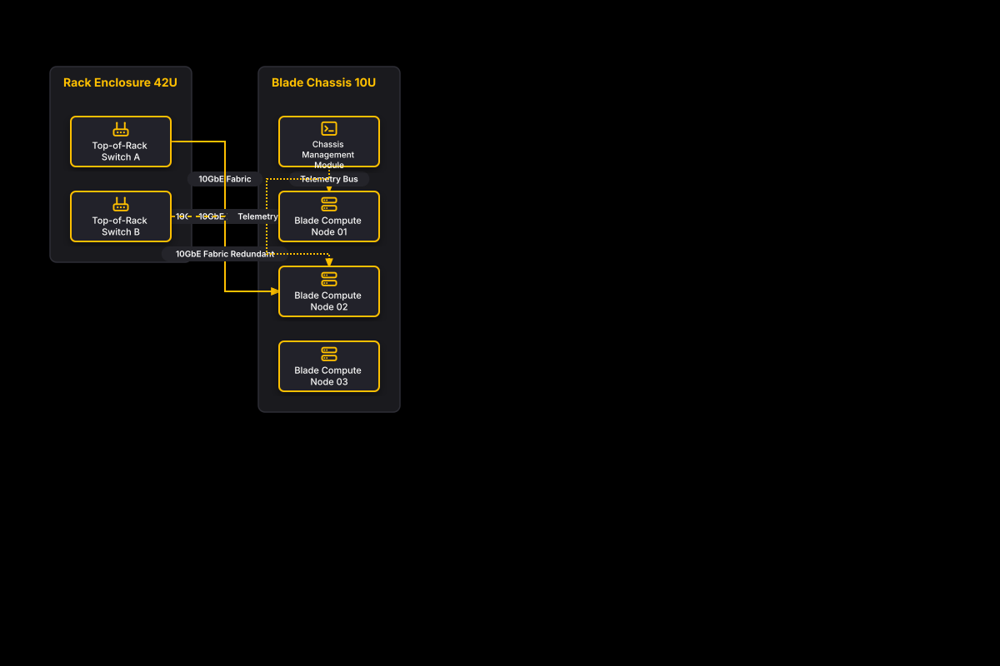

# High-Density Blade Server Enclosure

## Bill of Materials

| Symbol / ID | Label | Kind | Group | Technical Notes / Metadata |
| :--- | :--- | :--- | :--- | :--- |
| `tor1` | **Top-of-Rack Switch A** | box | Rack Enclosure 42U | speed: 100GbE Uplinks |
| `tor2` | **Top-of-Rack Switch B** | box | Rack Enclosure 42U | speed: 100GbE Uplinks |
| `chassis_mgmt` | **Chassis Management Module** | box | Blade Chassis 10U | interface: IPMI / Redfish |
| `blade1` | **Blade Compute Node 01** | box | Blade Chassis 10U | specs: 2x Xeon Gold, 512GB |
| `blade2` | **Blade Compute Node 02** | box | Blade Chassis 10U | specs: 2x Xeon Gold, 512GB |
| `blade3` | **Blade Compute Node 03** | box | Blade Chassis 10U | specs: 2x Xeon Gold, 512GB |

## Connections

| Source | Target | Protocol / Label | Style | Routing |
| :--- | :--- | :--- | :--- | :--- |
| **Top-of-Rack Switch A** (`tor1`) | **Blade Compute Node 01** (`blade1`) | 10GbE Fabric | solid | orthogonal |
| **Top-of-Rack Switch B** (`tor2`) | **Blade Compute Node 01** (`blade1`) | 10GbE Fabric Redundant | dashed | orthogonal |
| **Top-of-Rack Switch A** (`tor1`) | **Blade Compute Node 02** (`blade2`) | 10GbE Fabric | solid | orthogonal |
| **Top-of-Rack Switch B** (`tor2`) | **Blade Compute Node 02** (`blade2`) | 10GbE Fabric Redundant | dashed | orthogonal |
| **Chassis Management Module** (`chassis_mgmt`) | **Blade Compute Node 01** (`blade1`) | Telemetry Bus | dotted | orthogonal |
| **Chassis Management Module** (`chassis_mgmt`) | **Blade Compute Node 02** (`blade2`) | Telemetry Bus | dotted | orthogonal |
