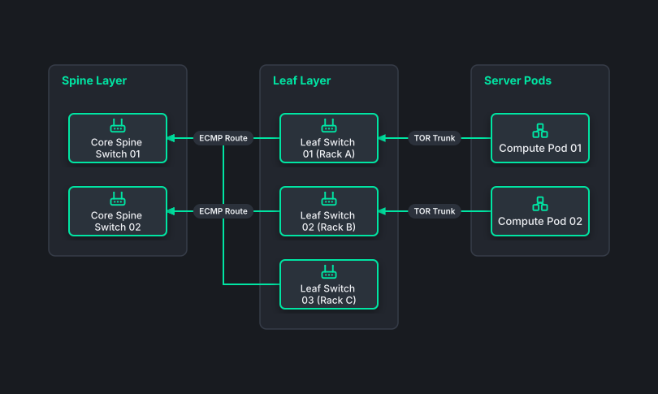

# Leaf-Spine Clos Datacenter Network

## Bill of Materials

| Symbol / ID | Label | Kind | Group | Technical Notes / Metadata |
| :--- | :--- | :--- | :--- | :--- |
| `spine1` | **Core Spine Switch 01** | box | Spine Layer | throughput: 32x 400GbE Ports |
| `spine2` | **Core Spine Switch 02** | box | Spine Layer | throughput: 32x 400GbE Ports |
| `leaf1` | **Leaf Switch 01 (Rack A)** | box | Leaf Layer | uplink: 2x 100GbE to Spines |
| `leaf2` | **Leaf Switch 02 (Rack B)** | box | Leaf Layer | uplink: 2x 100GbE to Spines |
| `leaf3` | **Leaf Switch 03 (Rack C)** | box | Leaf Layer | uplink: 2x 100GbE to Spines |
| `pod1` | **Compute Pod 01** | box | Server Pods | density: 40 Compute Nodes |
| `pod2` | **Compute Pod 02** | box | Server Pods | density: 40 Compute Nodes |

## Connections

| Source | Target | Protocol / Label | Style | Routing |
| :--- | :--- | :--- | :--- | :--- |
| **Leaf Switch 01 (Rack A)** (`leaf1`) | **Core Spine Switch 01** (`spine1`) | ECMP Route | solid | orthogonal |
| **Leaf Switch 01 (Rack A)** (`leaf1`) | **Core Spine Switch 02** (`spine2`) | ECMP Route | solid | orthogonal |
| **Leaf Switch 02 (Rack B)** (`leaf2`) | **Core Spine Switch 01** (`spine1`) | ECMP Route | solid | orthogonal |
| **Leaf Switch 02 (Rack B)** (`leaf2`) | **Core Spine Switch 02** (`spine2`) | ECMP Route | solid | orthogonal |
| **Leaf Switch 03 (Rack C)** (`leaf3`) | **Core Spine Switch 01** (`spine1`) | ECMP Route | solid | orthogonal |
| **Leaf Switch 03 (Rack C)** (`leaf3`) | **Core Spine Switch 02** (`spine2`) | ECMP Route | solid | orthogonal |
| **Compute Pod 01** (`pod1`) | **Leaf Switch 01 (Rack A)** (`leaf1`) | TOR Trunk | solid | orthogonal |
| **Compute Pod 02** (`pod2`) | **Leaf Switch 02 (Rack B)** (`leaf2`) | TOR Trunk | solid | orthogonal |
