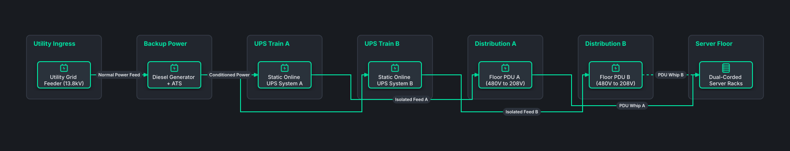

# Datacenter Power Distribution & 2N UPS

## Bill of Materials

| Symbol / ID | Label | Kind | Group | Technical Notes / Metadata |
| :--- | :--- | :--- | :--- | :--- |
| `utility` | **Utility Grid Feeder (13.8kV)** | box | Utility Ingress | capacity: 2.5 MVA |
| `gen_ats` | **Diesel Generator + ATS** | box | Backup Power | rating: 2000 kW Standby |
| `ups_a` | **Static Online UPS System A** | box | UPS Train A | runtime: 15 min Lithium-Ion |
| `ups_b` | **Static Online UPS System B** | box | UPS Train B | runtime: 15 min Lithium-Ion |
| `pdu_a` | **Floor PDU A (480V to 208V)** | box | Distribution A | breakers: 42 Circuits |
| `pdu_b` | **Floor PDU B (480V to 208V)** | box | Distribution B | breakers: 42 Circuits |
| `rack_feed` | **Dual-Corded Server Racks** | box | Server Floor | power: 2x 30A 208V Feeds |

## Connections

| Source | Target | Protocol / Label | Style | Routing |
| :--- | :--- | :--- | :--- | :--- |
| **Utility Grid Feeder (13.8kV)** (`utility`) | **Diesel Generator + ATS** (`gen_ats`) | Normal Power Feed | solid | orthogonal |
| **Diesel Generator + ATS** (`gen_ats`) | **Static Online UPS System A** (`ups_a`) | Conditioned Power | solid | orthogonal |
| **Diesel Generator + ATS** (`gen_ats`) | **Static Online UPS System B** (`ups_b`) | Conditioned Power | solid | orthogonal |
| **Static Online UPS System A** (`ups_a`) | **Floor PDU A (480V to 208V)** (`pdu_a`) | Isolated Feed A | solid | orthogonal |
| **Static Online UPS System B** (`ups_b`) | **Floor PDU B (480V to 208V)** (`pdu_b`) | Isolated Feed B | solid | orthogonal |
| **Floor PDU A (480V to 208V)** (`pdu_a`) | **Dual-Corded Server Racks** (`rack_feed`) | PDU Whip A | solid | orthogonal |
| **Floor PDU B (480V to 208V)** (`pdu_b`) | **Dual-Corded Server Racks** (`rack_feed`) | PDU Whip B | dashed | orthogonal |
