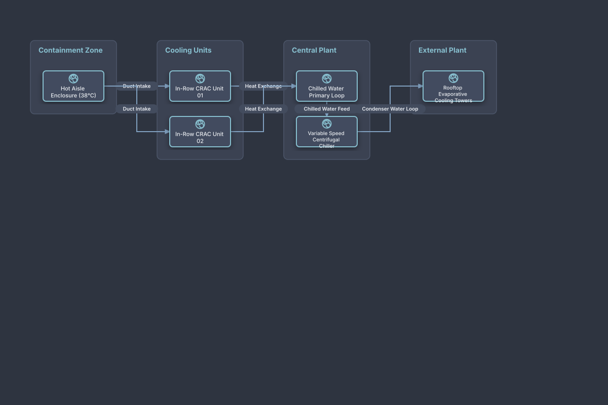

# Datacenter In-Row CRAC & Cooling Loops

## Bill of Materials

| Symbol / ID | Label | Kind | Group | Technical Notes / Metadata |
| :--- | :--- | :--- | :--- | :--- |
| `hot_aisle` | **Hot Aisle Enclosure (38°C)** | box | Containment Zone | exhaust: Encapsulated Airflow |
| `crac1` | **In-Row CRAC Unit 01** | box | Cooling Units | fan: Variable Speed EC Fans |
| `crac2` | **In-Row CRAC Unit 02** | box | Cooling Units | fan: Variable Speed EC Fans |
| `water_loop` | **Chilled Water Primary Loop** | box | Central Plant | temperature: 7°C Supply / 14°C Return |
| `chiller` | **Variable Speed Centrifugal Chiller** | box | Central Plant | cop: 6.2 COP Efficiency |
| `towers` | **Rooftop Evaporative Cooling Towers** | box | External Plant | wet_bulb: 24°C Design |

## Connections

| Source | Target | Protocol / Label | Style | Routing |
| :--- | :--- | :--- | :--- | :--- |
| **Hot Aisle Enclosure (38°C)** (`hot_aisle`) | **In-Row CRAC Unit 01** (`crac1`) | Duct Intake | solid | orthogonal |
| **Hot Aisle Enclosure (38°C)** (`hot_aisle`) | **In-Row CRAC Unit 02** (`crac2`) | Duct Intake | solid | orthogonal |
| **In-Row CRAC Unit 01** (`crac1`) | **Chilled Water Primary Loop** (`water_loop`) | Heat Exchange | solid | orthogonal |
| **In-Row CRAC Unit 02** (`crac2`) | **Chilled Water Primary Loop** (`water_loop`) | Heat Exchange | solid | orthogonal |
| **Chilled Water Primary Loop** (`water_loop`) | **Variable Speed Centrifugal Chiller** (`chiller`) | Chilled Water Feed | solid | orthogonal |
| **Variable Speed Centrifugal Chiller** (`chiller`) | **Rooftop Evaporative Cooling Towers** (`towers`) | Condenser Water Loop | solid | orthogonal |
