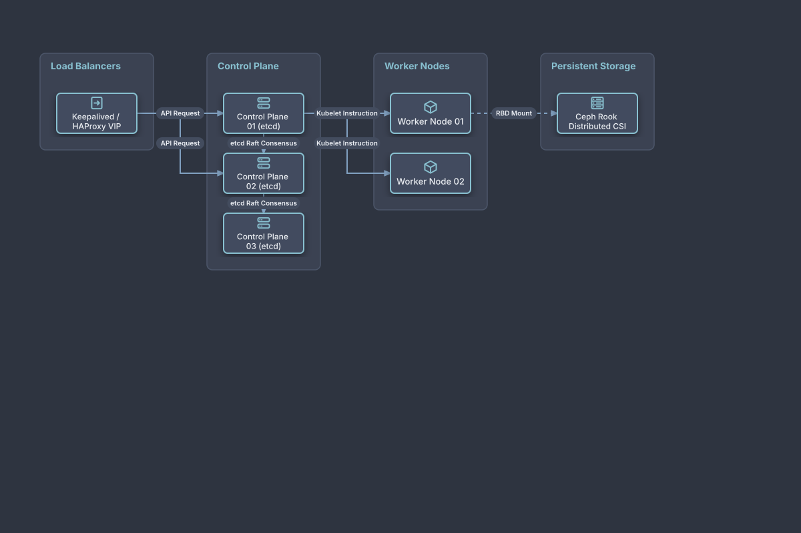

# Bare-Metal Kubernetes High Availability

## Bill of Materials

| Symbol / ID | Label | Kind | Group | Technical Notes / Metadata |
| :--- | :--- | :--- | :--- | :--- |
| `vip_lb` | **Keepalived / HAProxy VIP** | box | Load Balancers | virtual_ip: 10.0.0.10:6443 |
| `master1` | **Control Plane 01 (etcd)** | box | Control Plane | quorum: Member 1/3 |
| `master2` | **Control Plane 02 (etcd)** | box | Control Plane | quorum: Member 2/3 |
| `master3` | **Control Plane 03 (etcd)** | box | Control Plane | quorum: Member 3/3 |
| `worker1` | **Worker Node 01** | box | Worker Nodes | cni: Calico BGP |
| `worker2` | **Worker Node 02** | box | Worker Nodes | cni: Calico BGP |
| `ceph` | **Ceph Rook Distributed CSI** | box | Persistent Storage | type: NVMe Block Pool |

## Connections

| Source | Target | Protocol / Label | Style | Routing |
| :--- | :--- | :--- | :--- | :--- |
| **Keepalived / HAProxy VIP** (`vip_lb`) | **Control Plane 01 (etcd)** (`master1`) | API Request | solid | orthogonal |
| **Keepalived / HAProxy VIP** (`vip_lb`) | **Control Plane 02 (etcd)** (`master2`) | API Request | solid | orthogonal |
| **Control Plane 01 (etcd)** (`master1`) | **Control Plane 02 (etcd)** (`master2`) | etcd Raft Consensus | dashed | orthogonal |
| **Control Plane 02 (etcd)** (`master2`) | **Control Plane 03 (etcd)** (`master3`) | etcd Raft Consensus | dashed | orthogonal |
| **Control Plane 01 (etcd)** (`master1`) | **Worker Node 01** (`worker1`) | Kubelet Instruction | solid | orthogonal |
| **Control Plane 01 (etcd)** (`master1`) | **Worker Node 02** (`worker2`) | Kubelet Instruction | solid | orthogonal |
| **Worker Node 01** (`worker1`) | **Ceph Rook Distributed CSI** (`ceph`) | RBD Mount | dashed | orthogonal |
