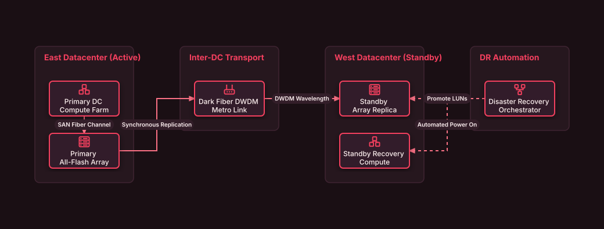

# Metro Disaster Recovery Datacenter Pair

## Bill of Materials

| Symbol / ID | Label | Kind | Group | Technical Notes / Metadata |
| :--- | :--- | :--- | :--- | :--- |
| `dc_east_compute` | **Primary DC Compute Farm** | box | East Datacenter (Active) | vms: 2,500 Production VMs |
| `dc_east_san` | **Primary All-Flash Array** | box | East Datacenter (Active) | rpo: Zero Data Loss |
| `dwdm` | **Dark Fiber DWDM Metro Link** | box | Inter-DC Transport | latency: 0.8ms Round-Trip |
| `dc_west_san` | **Standby Array Replica** | box | West Datacenter (Standby) | sync: Synchronous Mirror |
| `dc_west_compute` | **Standby Recovery Compute** | box | West Datacenter (Standby) | hosts: Cold Standby Farm |
| `dr_orchestrator` | **Disaster Recovery Orchestrator** | box | DR Automation | failover: 1-Click Runbook |

## Connections

| Source | Target | Protocol / Label | Style | Routing |
| :--- | :--- | :--- | :--- | :--- |
| **Primary DC Compute Farm** (`dc_east_compute`) | **Primary All-Flash Array** (`dc_east_san`) | SAN Fiber Channel | solid | orthogonal |
| **Primary All-Flash Array** (`dc_east_san`) | **Dark Fiber DWDM Metro Link** (`dwdm`) | Synchronous Replication | solid | orthogonal |
| **Dark Fiber DWDM Metro Link** (`dwdm`) | **Standby Array Replica** (`dc_west_san`) | DWDM Wavelength | solid | orthogonal |
| **Disaster Recovery Orchestrator** (`dr_orchestrator`) | **Standby Recovery Compute** (`dc_west_compute`) | Automated Power On | dashed | orthogonal |
| **Disaster Recovery Orchestrator** (`dr_orchestrator`) | **Standby Array Replica** (`dc_west_san`) | Promote LUNs | dashed | orthogonal |
