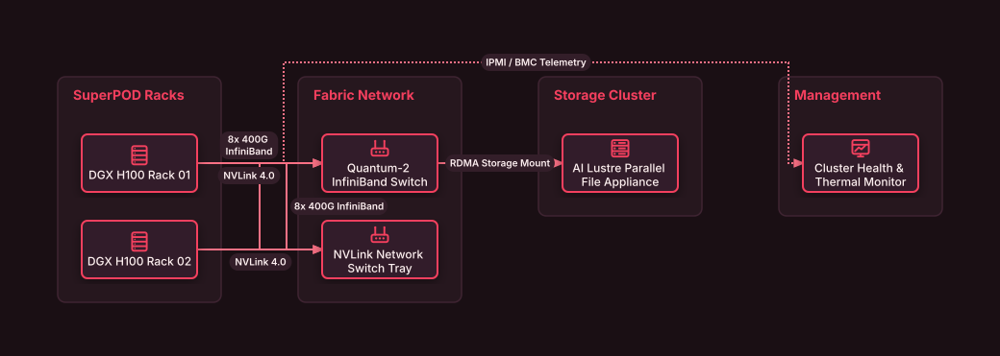

# High-Density AI Supercomputing Pod

## Bill of Materials

| Symbol / ID | Label | Kind | Group | Technical Notes / Metadata |
| :--- | :--- | :--- | :--- | :--- |
| `dgx_rack1` | **DGX H100 Rack 01** | box | SuperPOD Racks | compute: 8x H100 SXM5 640GB |
| `dgx_rack2` | **DGX H100 Rack 02** | box | SuperPOD Racks | compute: 8x H100 SXM5 640GB |
| `ib_spine` | **Quantum-2 InfiniBand Switch** | box | Fabric Network | speed: NDR 400 Gbps |
| `nvlink_switch` | **NVLink Network Switch Tray** | box | Fabric Network | bandwidth: 7.2 TB/s Bisection |
| `storage_appliance` | **AI Lustre Parallel File Appliance** | box | Storage Cluster | iops: 10 Million IOPS |
| `telemetry_node` | **Cluster Health & Thermal Monitor** | box | Management | sensors: Cooling / Leak Detect |

## Connections

| Source | Target | Protocol / Label | Style | Routing |
| :--- | :--- | :--- | :--- | :--- |
| **DGX H100 Rack 01** (`dgx_rack1`) | **NVLink Network Switch Tray** (`nvlink_switch`) | NVLink 4.0 | solid | orthogonal |
| **DGX H100 Rack 02** (`dgx_rack2`) | **NVLink Network Switch Tray** (`nvlink_switch`) | NVLink 4.0 | solid | orthogonal |
| **DGX H100 Rack 01** (`dgx_rack1`) | **Quantum-2 InfiniBand Switch** (`ib_spine`) | 8x 400G InfiniBand | solid | orthogonal |
| **DGX H100 Rack 02** (`dgx_rack2`) | **Quantum-2 InfiniBand Switch** (`ib_spine`) | 8x 400G InfiniBand | solid | orthogonal |
| **Quantum-2 InfiniBand Switch** (`ib_spine`) | **AI Lustre Parallel File Appliance** (`storage_appliance`) | RDMA Storage Mount | solid | orthogonal |
| **DGX H100 Rack 01** (`dgx_rack1`) | **Cluster Health & Thermal Monitor** (`telemetry_node`) | IPMI / BMC Telemetry | dotted | orthogonal |
