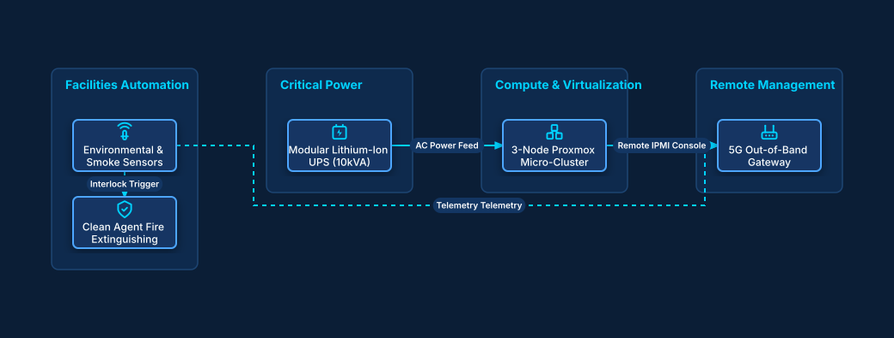

# Modular Edge Micro-Datacenter Container

## Bill of Materials

| Symbol / ID | Label | Kind | Group | Technical Notes / Metadata |
| :--- | :--- | :--- | :--- | :--- |
| `env_sensors` | **Environmental & Smoke Sensors** | box | Facilities Automation | detection: VESDA Laser Air |
| `fire_suppress` | **Clean Agent Fire Extinguishing** | box | Facilities Automation | agent: Novec 1230 |
| `ups_lithium` | **Modular Lithium-Ion UPS (10kVA)** | box | Critical Power | runtime: 45 Minutes |
| `hyperconverged` | **3-Node Proxmox Micro-Cluster** | box | Compute & Virtualization | storage: Ceph Full Mesh |
| `cellular_oob` | **5G Out-of-Band Gateway** | box | Remote Management | failover: Dual SIM Cellular |

## Connections

| Source | Target | Protocol / Label | Style | Routing |
| :--- | :--- | :--- | :--- | :--- |
| **Environmental & Smoke Sensors** (`env_sensors`) | **Clean Agent Fire Extinguishing** (`fire_suppress`) | Interlock Trigger | dashed | orthogonal |
| **Modular Lithium-Ion UPS (10kVA)** (`ups_lithium`) | **3-Node Proxmox Micro-Cluster** (`hyperconverged`) | AC Power Feed | solid | orthogonal |
| **3-Node Proxmox Micro-Cluster** (`hyperconverged`) | **5G Out-of-Band Gateway** (`cellular_oob`) | Remote IPMI Console | solid | orthogonal |
| **Environmental & Smoke Sensors** (`env_sensors`) | **5G Out-of-Band Gateway** (`cellular_oob`) | Telemetry Telemetry | dashed | orthogonal |
