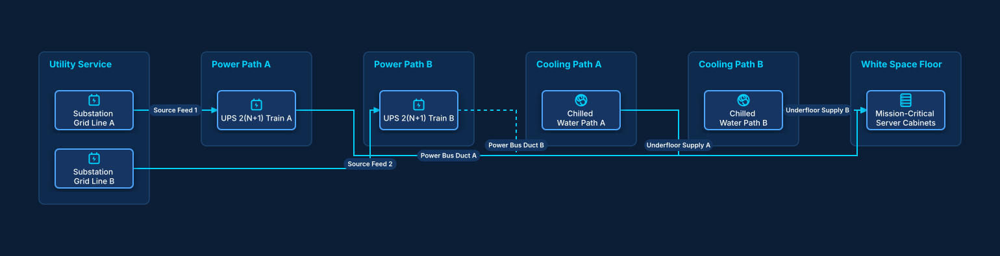

# Tier IV Concurrently Maintainable Datacenter

## Bill of Materials

| Symbol / ID | Label | Kind | Group | Technical Notes / Metadata |
| :--- | :--- | :--- | :--- | :--- |
| `grid_a` | **Substation Grid Line A** | box | Utility Service | feed: 34.5kV Dedicated Feed |
| `grid_b` | **Substation Grid Line B** | box | Utility Service | feed: 34.5kV Diverse Path |
| `ups_train_a` | **UPS 2(N+1) Train A** | box | Power Path A | efficiency: 97% Double Conversion |
| `ups_train_b` | **UPS 2(N+1) Train B** | box | Power Path B | efficiency: 97% Double Conversion |
| `crac_loop_a` | **Chilled Water Path A** | box | Cooling Path A | pumps: Variable Secondary |
| `crac_loop_b` | **Chilled Water Path B** | box | Cooling Path B | pumps: Variable Secondary |
| `mission_rack` | **Mission-Critical Server Cabinets** | box | White Space Floor | sla: 99.995% Availability |

## Connections

| Source | Target | Protocol / Label | Style | Routing |
| :--- | :--- | :--- | :--- | :--- |
| **Substation Grid Line A** (`grid_a`) | **UPS 2(N+1) Train A** (`ups_train_a`) | Source Feed 1 | solid | orthogonal |
| **Substation Grid Line B** (`grid_b`) | **UPS 2(N+1) Train B** (`ups_train_b`) | Source Feed 2 | solid | orthogonal |
| **UPS 2(N+1) Train A** (`ups_train_a`) | **Mission-Critical Server Cabinets** (`mission_rack`) | Power Bus Duct A | solid | orthogonal |
| **UPS 2(N+1) Train B** (`ups_train_b`) | **Mission-Critical Server Cabinets** (`mission_rack`) | Power Bus Duct B | dashed | orthogonal |
| **Chilled Water Path A** (`crac_loop_a`) | **Mission-Critical Server Cabinets** (`mission_rack`) | Underfloor Supply A | solid | orthogonal |
| **Chilled Water Path B** (`crac_loop_b`) | **Mission-Critical Server Cabinets** (`mission_rack`) | Underfloor Supply B | dashed | orthogonal |
