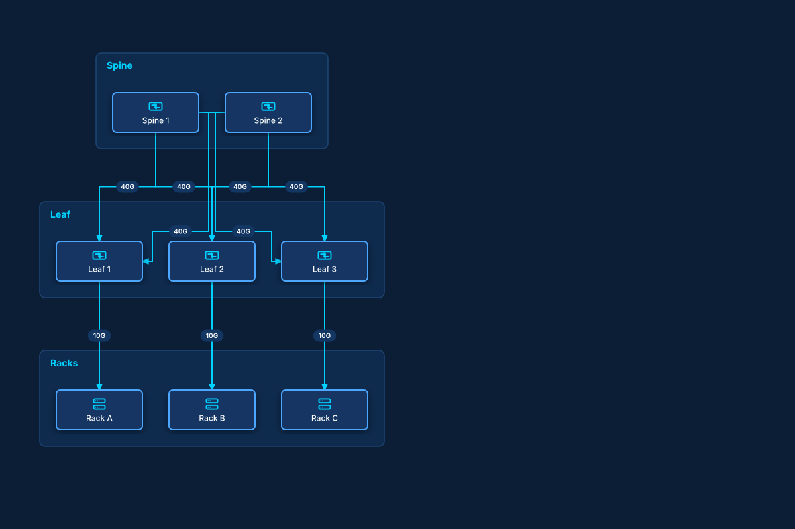

# Auto-Laid-Out Spine-Leaf Fabric

## Bill of Materials

| Symbol / ID | Label | Kind | Group | Technical Notes / Metadata |
| :--- | :--- | :--- | :--- | :--- |
| `shape_2` | **Spine 1** | box | Spine | - |
| `shape_3` | **Spine 2** | box | Spine | - |
| `shape_5` | **Leaf 1** | box | Leaf | - |
| `shape_6` | **Leaf 2** | box | Leaf | - |
| `shape_7` | **Leaf 3** | box | Leaf | - |
| `shape_9` | **Rack A** | box | Racks | - |
| `shape_10` | **Rack B** | box | Racks | - |
| `shape_11` | **Rack C** | box | Racks | - |

## Connections

| Source | Target | Protocol / Label | Style | Routing |
| :--- | :--- | :--- | :--- | :--- |
| **Spine 1** (`shape_2`) | **Leaf 1** (`shape_5`) | 40G | solid | orthogonal |
| **Spine 1** (`shape_2`) | **Leaf 2** (`shape_6`) | 40G | solid | orthogonal |
| **Spine 1** (`shape_2`) | **Leaf 3** (`shape_7`) | 40G | solid | orthogonal |
| **Spine 2** (`shape_3`) | **Leaf 1** (`shape_5`) | 40G | solid | orthogonal |
| **Spine 2** (`shape_3`) | **Leaf 2** (`shape_6`) | 40G | solid | orthogonal |
| **Spine 2** (`shape_3`) | **Leaf 3** (`shape_7`) | 40G | solid | orthogonal |
| **Leaf 1** (`shape_5`) | **Rack A** (`shape_9`) | 10G | solid | orthogonal |
| **Leaf 2** (`shape_6`) | **Rack B** (`shape_10`) | 10G | solid | orthogonal |
| **Leaf 3** (`shape_7`) | **Rack C** (`shape_11`) | 10G | solid | orthogonal |
