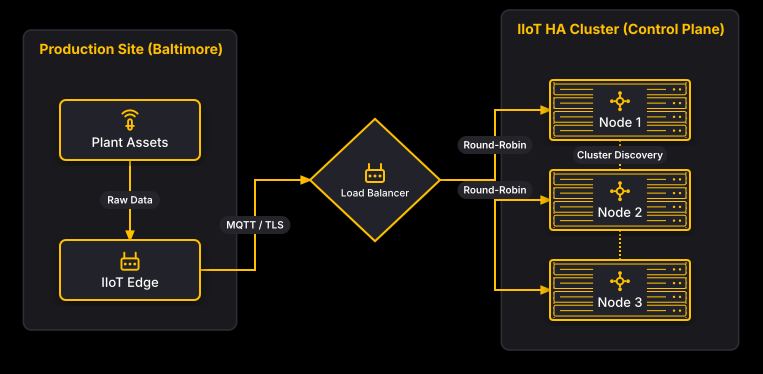

# IIoT High Availability UNS

## Bill of Materials

| Symbol / ID | Label | Kind | Group | Technical Notes / Metadata |
| :--- | :--- | :--- | :--- | :--- |
| `shape_2` | **Plant Assets** | box | Production Site (Baltimore) | type: Sensors & Actuators, protocol: Modbus/TCP |
| `shape_3` | **IIoT Edge** | box | Production Site (Baltimore) | role: Edge Gateway, tier: Production Tier 1 |
| `shape_4` | **Load Balancer** | diamond | - | type: HAProxy / AWS NLB, layer: Transport |
| `shape_6` | **Node 1** | server_rack | IIoT HA Cluster (Control Plane) | role: UNS Primary Leader, cluster_id: ha-cluster-01 |
| `shape_7` | **Node 2** | server_rack | IIoT HA Cluster (Control Plane) | role: UNS Replica Follower, cluster_id: ha-cluster-01 |
| `shape_8` | **Node 3** | server_rack | IIoT HA Cluster (Control Plane) | role: UNS Replica Follower, cluster_id: ha-cluster-01 |

## Connections

| Source | Target | Protocol / Label | Style | Routing |
| :--- | :--- | :--- | :--- | :--- |
| **Plant Assets** (`shape_2`) | **IIoT Edge** (`shape_3`) | Raw Data | solid | orthogonal |
| **IIoT Edge** (`shape_3`) | **Load Balancer** (`shape_4`) | MQTT / TLS | solid | orthogonal |
| **Load Balancer** (`shape_4`) | **Node 1** (`shape_6`) | Round-Robin | solid | orthogonal |
| **Load Balancer** (`shape_4`) | **Node 2** (`shape_7`) | Round-Robin | solid | orthogonal |
| **Load Balancer** (`shape_4`) | **Node 3** (`shape_8`) | Round-Robin | solid | orthogonal |
| **Node 1** (`shape_6`) | **Node 2** (`shape_7`) | Cluster Discovery | dotted | orthogonal |
| **Node 2** (`shape_7`) | **Node 3** (`shape_8`) | - | dotted | orthogonal |
