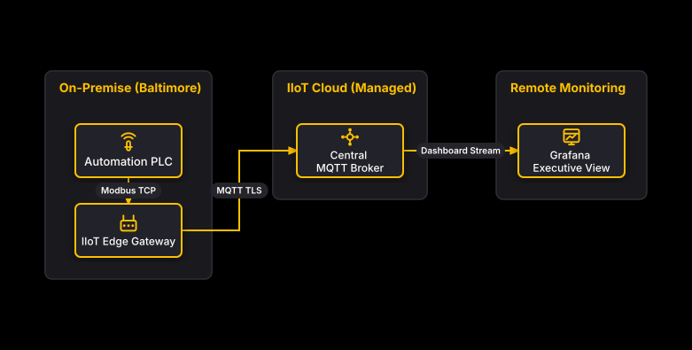

# Baltimore Plant to Managed Cloud

## Bill of Materials

| Symbol / ID | Label | Kind | Group | Technical Notes / Metadata |
| :--- | :--- | :--- | :--- | :--- |
| `plc` | **Automation PLC** | box | On-Premise (Baltimore) | vendor: Siemens S7-1500, protocol: Modbus |
| `edge` | **IIoT Edge Gateway** | box | On-Premise (Baltimore) | runtime: Node-RED, specs: IPC |
| `broker` | **Central MQTT Broker** | box | IIoT Cloud (Managed) | service: UNS Broker, qos: QoS 1 |
| `dashboard` | **Grafana Executive View** | box | Remote Monitoring | app: Grafana Cloud, kpis: OEE |

## Connections

| Source | Target | Protocol / Label | Style | Routing |
| :--- | :--- | :--- | :--- | :--- |
| **Automation PLC** (`plc`) | **IIoT Edge Gateway** (`edge`) | Modbus TCP | solid | orthogonal |
| **IIoT Edge Gateway** (`edge`) | **Central MQTT Broker** (`broker`) | MQTT TLS | solid | orthogonal |
| **Central MQTT Broker** (`broker`) | **Grafana Executive View** (`dashboard`) | Dashboard Stream | solid | orthogonal |
