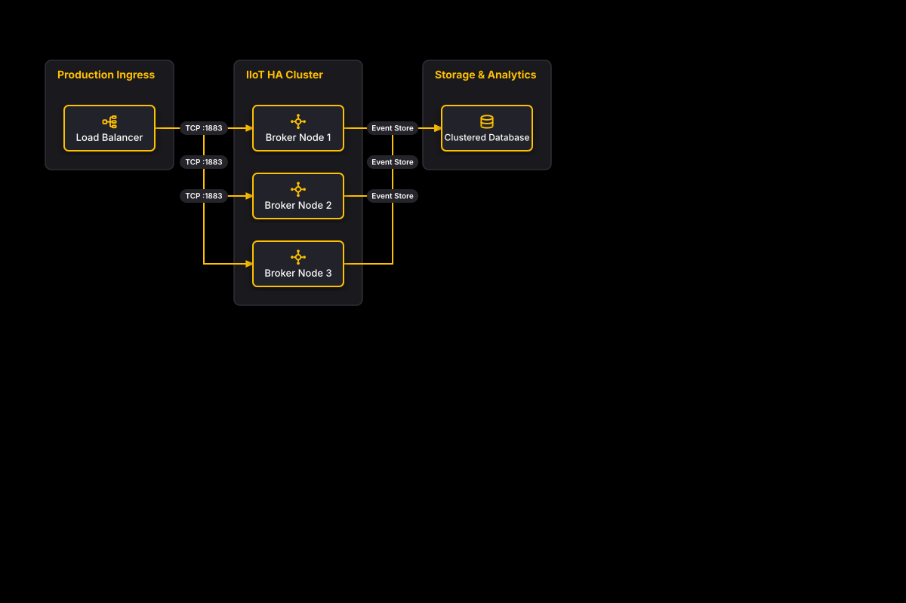

# High Availability Broker Cluster

## Bill of Materials

| Symbol / ID | Label | Kind | Group | Technical Notes / Metadata |
| :--- | :--- | :--- | :--- | :--- |
| `lb` | **Load Balancer** | box | Production Ingress | algorithm: Round Robin, vip: 10.0.0.10 |
| `node1` | **Broker Node 1** | box | IIoT HA Cluster | role: Active, zone: Zone A |
| `node2` | **Broker Node 2** | box | IIoT HA Cluster | role: Active, zone: Zone B |
| `node3` | **Broker Node 3** | box | IIoT HA Cluster | role: Active, zone: Zone C |
| `db` | **Clustered Database** | box | Storage & Analytics | engine: PostgreSQL 16, ha: Multi-AZ |

## Connections

| Source | Target | Protocol / Label | Style | Routing |
| :--- | :--- | :--- | :--- | :--- |
| **Load Balancer** (`lb`) | **Broker Node 1** (`node1`) | TCP :1883 | solid | orthogonal |
| **Load Balancer** (`lb`) | **Broker Node 2** (`node2`) | TCP :1883 | solid | orthogonal |
| **Load Balancer** (`lb`) | **Broker Node 3** (`node3`) | TCP :1883 | solid | orthogonal |
| **Broker Node 1** (`node1`) | **Clustered Database** (`db`) | Event Store | solid | orthogonal |
| **Broker Node 2** (`node2`) | **Clustered Database** (`db`) | Event Store | solid | orthogonal |
| **Broker Node 3** (`node3`) | **Clustered Database** (`db`) | Event Store | solid | orthogonal |
