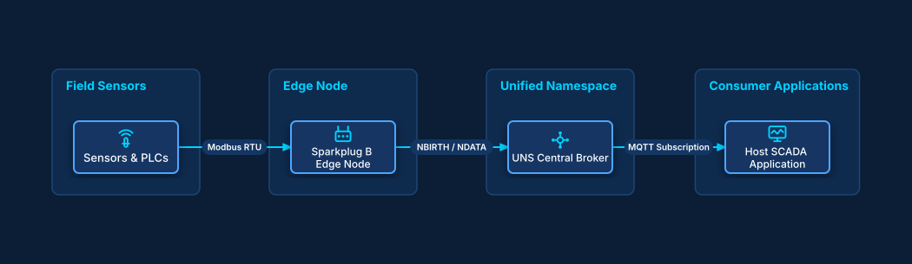

# Sparkplug B Unified Namespace

## Bill of Materials

| Symbol / ID | Label | Kind | Group | Technical Notes / Metadata |
| :--- | :--- | :--- | :--- | :--- |
| `sensors` | **Sensors & PLCs** | box | Field Sensors | io: 4-20mA / Modbus |
| `eon` | **Sparkplug B Edge Node** | box | Edge Node | compression: Gzip, payload: Protobuf |
| `broker` | **UNS Central Broker** | box | Unified Namespace | namespace: spBv1.0/Plant1 |
| `scada` | **Host SCADA Application** | box | Consumer Applications | role: Primary Application |

## Connections

| Source | Target | Protocol / Label | Style | Routing |
| :--- | :--- | :--- | :--- | :--- |
| **Sensors & PLCs** (`sensors`) | **Sparkplug B Edge Node** (`eon`) | Modbus RTU | solid | orthogonal |
| **Sparkplug B Edge Node** (`eon`) | **UNS Central Broker** (`broker`) | NBIRTH / NDATA | solid | orthogonal |
| **UNS Central Broker** (`broker`) | **Host SCADA Application** (`scada`) | MQTT Subscription | solid | orthogonal |
