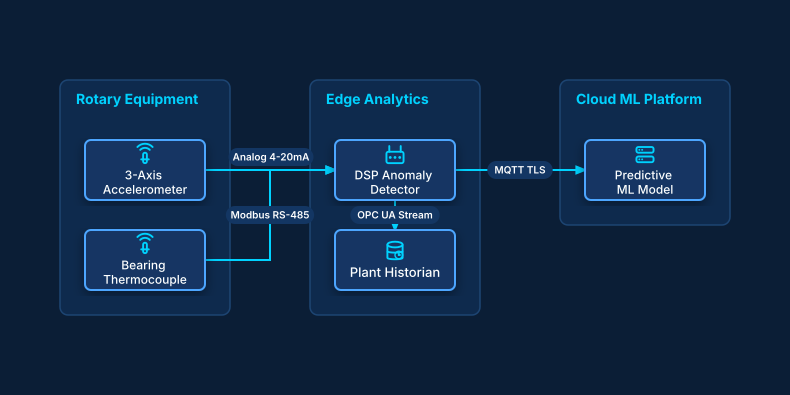

# Predictive Maintenance Vibration Analysis

## Bill of Materials

| Symbol / ID | Label | Kind | Group | Technical Notes / Metadata |
| :--- | :--- | :--- | :--- | :--- |
| `sensor_x` | **3-Axis Accelerometer** | box | Rotary Equipment | sampling: 10kHz, axis: X/Y/Z |
| `temp_sensor` | **Bearing Thermocouple** | box | Rotary Equipment | range: -40..150C |
| `edge_dsp` | **DSP Anomaly Detector** | box | Edge Analytics | algorithm: FFT Peak Detection |
| `historian` | **Plant Historian** | box | Edge Analytics | retention: 90 Days |
| `cloud_ml` | **Predictive ML Model** | box | Cloud ML Platform | rul: Remaining Useful Life |

## Connections

| Source | Target | Protocol / Label | Style | Routing |
| :--- | :--- | :--- | :--- | :--- |
| **3-Axis Accelerometer** (`sensor_x`) | **DSP Anomaly Detector** (`edge_dsp`) | Analog 4-20mA | solid | orthogonal |
| **Bearing Thermocouple** (`temp_sensor`) | **DSP Anomaly Detector** (`edge_dsp`) | Modbus RS-485 | solid | orthogonal |
| **DSP Anomaly Detector** (`edge_dsp`) | **Plant Historian** (`historian`) | OPC UA Stream | solid | orthogonal |
| **DSP Anomaly Detector** (`edge_dsp`) | **Predictive ML Model** (`cloud_ml`) | MQTT TLS | solid | orthogonal |
