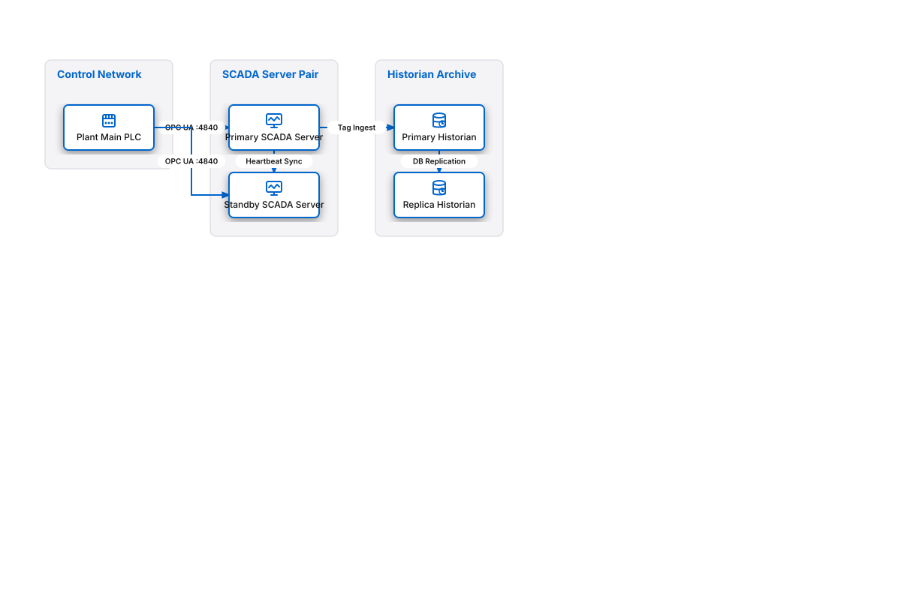

# SCADA & Historian Dual Redundancy

## Bill of Materials

| Symbol / ID | Label | Kind | Group | Technical Notes / Metadata |
| :--- | :--- | :--- | :--- | :--- |
| `plc_main` | **Plant Main PLC** | box | Control Network | cpu: Redundant Rack |
| `scada_pri` | **Primary SCADA Server** | box | SCADA Server Pair | state: Active Host |
| `scada_sec` | **Standby SCADA Server** | box | SCADA Server Pair | state: Hot Standby |
| `hist_pri` | **Primary Historian** | box | Historian Archive | storage: NVMe RAID |
| `hist_sec` | **Replica Historian** | box | Historian Archive | sync: Async Stream |

## Connections

| Source | Target | Protocol / Label | Style | Routing |
| :--- | :--- | :--- | :--- | :--- |
| **Plant Main PLC** (`plc_main`) | **Primary SCADA Server** (`scada_pri`) | OPC UA :4840 | solid | orthogonal |
| **Plant Main PLC** (`plc_main`) | **Standby SCADA Server** (`scada_sec`) | OPC UA :4840 | solid | orthogonal |
| **Primary SCADA Server** (`scada_pri`) | **Standby SCADA Server** (`scada_sec`) | Heartbeat Sync | dashed | orthogonal |
| **Primary SCADA Server** (`scada_pri`) | **Primary Historian** (`hist_pri`) | Tag Ingest | solid | orthogonal |
| **Primary Historian** (`hist_pri`) | **Replica Historian** (`hist_sec`) | DB Replication | solid | orthogonal |
