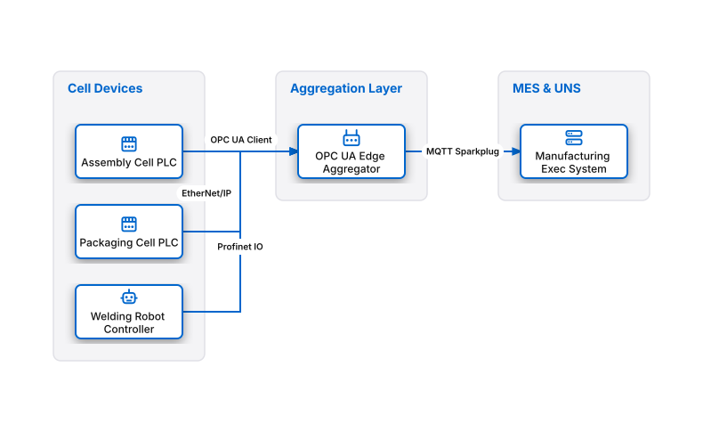

# OPC UA TSN Edge Aggregator

## Bill of Materials

| Symbol / ID | Label | Kind | Group | Technical Notes / Metadata |
| :--- | :--- | :--- | :--- | :--- |
| `plc_cell1` | **Assembly Cell PLC** | box | Cell Devices | vendor: Siemens |
| `plc_cell2` | **Packaging Cell PLC** | box | Cell Devices | vendor: Rockwell |
| `robot_cell` | **Welding Robot Controller** | box | Cell Devices | protocol: Profinet |
| `agg_gw` | **OPC UA Edge Aggregator** | box | Aggregation Layer | model: Unified Node-RED |
| `mes` | **Manufacturing Exec System** | box | MES & UNS | tier: ISA-95 Level 3 |

## Connections

| Source | Target | Protocol / Label | Style | Routing |
| :--- | :--- | :--- | :--- | :--- |
| **Assembly Cell PLC** (`plc_cell1`) | **OPC UA Edge Aggregator** (`agg_gw`) | OPC UA Client | solid | orthogonal |
| **Packaging Cell PLC** (`plc_cell2`) | **OPC UA Edge Aggregator** (`agg_gw`) | EtherNet/IP | solid | orthogonal |
| **Welding Robot Controller** (`robot_cell`) | **OPC UA Edge Aggregator** (`agg_gw`) | Profinet IO | solid | orthogonal |
| **OPC UA Edge Aggregator** (`agg_gw`) | **Manufacturing Exec System** (`mes`) | MQTT Sparkplug | solid | orthogonal |
