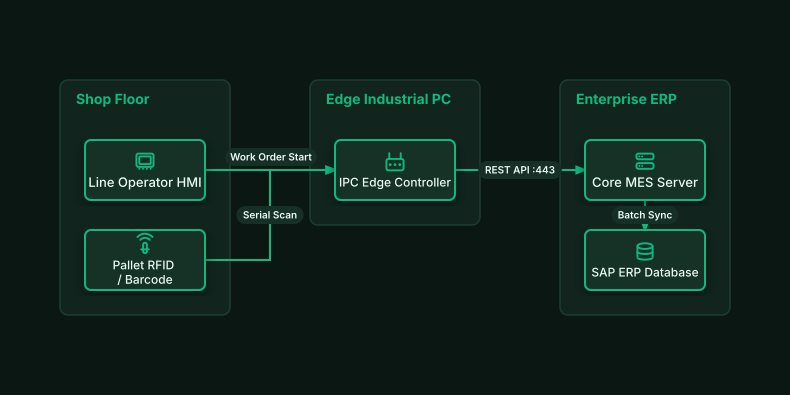

# Smart Factory MES & ERP Integration

## Bill of Materials

| Symbol / ID | Label | Kind | Group | Technical Notes / Metadata |
| :--- | :--- | :--- | :--- | :--- |
| `hmi_station` | **Line Operator HMI** | box | Shop Floor | screen: 15-inch Touch |
| `barcode_scan` | **Pallet RFID / Barcode** | box | Shop Floor | type: Fixed Mount |
| `ipc_worker` | **IPC Edge Controller** | box | Edge Industrial PC | runtime: Linux IPC |
| `mes_core` | **Core MES Server** | box | Enterprise ERP | function: OEE & Dispatch |
| `erp_db` | **SAP ERP Database** | box | Enterprise ERP | modules: MM / PP / QM |

## Connections

| Source | Target | Protocol / Label | Style | Routing |
| :--- | :--- | :--- | :--- | :--- |
| **Line Operator HMI** (`hmi_station`) | **IPC Edge Controller** (`ipc_worker`) | Work Order Start | solid | orthogonal |
| **Pallet RFID / Barcode** (`barcode_scan`) | **IPC Edge Controller** (`ipc_worker`) | Serial Scan | solid | orthogonal |
| **IPC Edge Controller** (`ipc_worker`) | **Core MES Server** (`mes_core`) | REST API :443 | solid | orthogonal |
| **Core MES Server** (`mes_core`) | **SAP ERP Database** (`erp_db`) | Batch Sync | solid | orthogonal |
