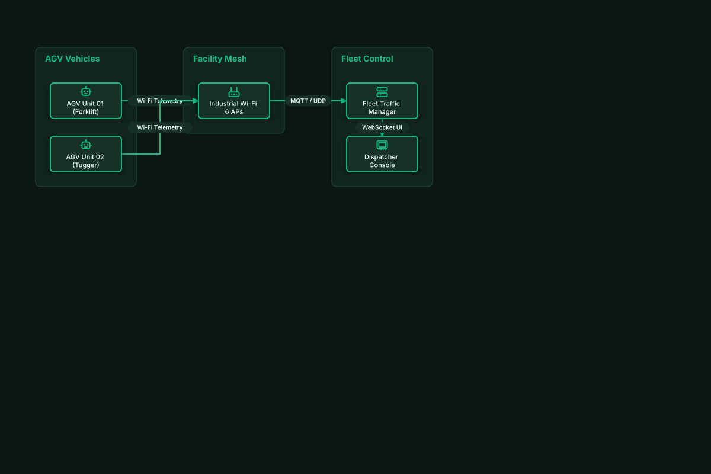

# AGV Fleet Telemetry & Traffic Management

## Bill of Materials

| Symbol / ID | Label | Kind | Group | Technical Notes / Metadata |
| :--- | :--- | :--- | :--- | :--- |
| `agv_1` | **AGV Unit 01 (Forklift)** | box | AGV Vehicles | battery: LiFePO4 48V |
| `agv_2` | **AGV Unit 02 (Tugger)** | box | AGV Vehicles | payload: 1000kg |
| `ap_mesh` | **Industrial Wi-Fi 6 APs** | box | Facility Mesh | coverage: Plant-wide |
| `fleet_srv` | **Fleet Traffic Manager** | box | Fleet Control | algo: Dynamic Routing |
| `hmi_disp` | **Dispatcher Console** | box | Fleet Control | view: Realtime Floor Map |

## Connections

| Source | Target | Protocol / Label | Style | Routing |
| :--- | :--- | :--- | :--- | :--- |
| **AGV Unit 01 (Forklift)** (`agv_1`) | **Industrial Wi-Fi 6 APs** (`ap_mesh`) | Wi-Fi Telemetry | solid | orthogonal |
| **AGV Unit 02 (Tugger)** (`agv_2`) | **Industrial Wi-Fi 6 APs** (`ap_mesh`) | Wi-Fi Telemetry | solid | orthogonal |
| **Industrial Wi-Fi 6 APs** (`ap_mesh`) | **Fleet Traffic Manager** (`fleet_srv`) | MQTT / UDP | solid | orthogonal |
| **Fleet Traffic Manager** (`fleet_srv`) | **Dispatcher Console** (`hmi_disp`) | WebSocket UI | solid | orthogonal |
