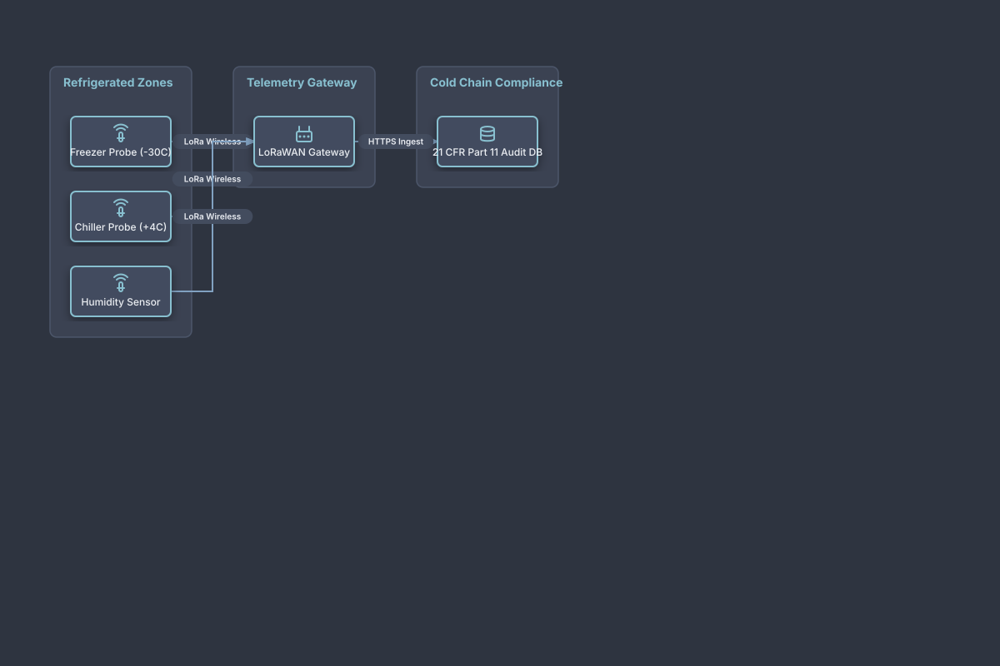

# Cold Chain Environmental Monitoring

## Bill of Materials

| Symbol / ID | Label | Kind | Group | Technical Notes / Metadata |
| :--- | :--- | :--- | :--- | :--- |
| `temp_probe1` | **Freezer Probe (-30C)** | box | Refrigerated Zones | accuracy: +-0.1C |
| `temp_probe2` | **Chiller Probe (+4C)** | box | Refrigerated Zones | accuracy: +-0.2C |
| `hum_probe` | **Humidity Sensor** | box | Refrigerated Zones | range: 10-90% RH |
| `lora_gw` | **LoRaWAN Gateway** | box | Telemetry Gateway | freq: 915 MHz |
| `audit_db` | **21 CFR Part 11 Audit DB** | box | Cold Chain Compliance | audit: Immutable Log |

## Connections

| Source | Target | Protocol / Label | Style | Routing |
| :--- | :--- | :--- | :--- | :--- |
| **Freezer Probe (-30C)** (`temp_probe1`) | **LoRaWAN Gateway** (`lora_gw`) | LoRa Wireless | solid | orthogonal |
| **Chiller Probe (+4C)** (`temp_probe2`) | **LoRaWAN Gateway** (`lora_gw`) | LoRa Wireless | solid | orthogonal |
| **Humidity Sensor** (`hum_probe`) | **LoRaWAN Gateway** (`lora_gw`) | LoRa Wireless | solid | orthogonal |
| **LoRaWAN Gateway** (`lora_gw`) | **21 CFR Part 11 Audit DB** (`audit_db`) | HTTPS Ingest | solid | orthogonal |
