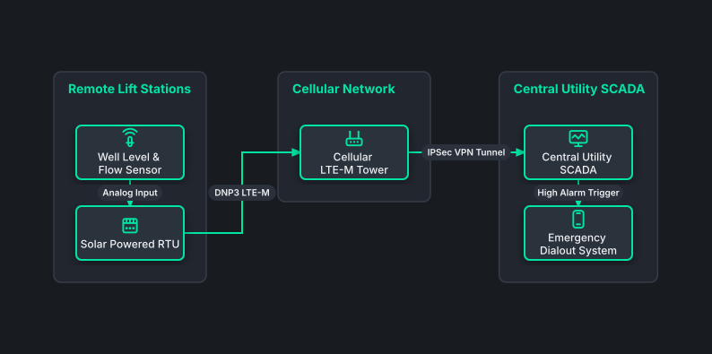

# Water & Wastewater Remote RTU Mesh

## Bill of Materials

| Symbol / ID | Label | Kind | Group | Technical Notes / Metadata |
| :--- | :--- | :--- | :--- | :--- |
| `pump_sens` | **Well Level & Flow Sensor** | box | Remote Lift Stations | sensor: Submersible 4-20mA |
| `solar_rtu` | **Solar Powered RTU** | box | Remote Lift Stations | power: Solar / 24V Batt |
| `cell_tower` | **Cellular LTE-M Tower** | box | Cellular Network | apn: Private Utility APN |
| `scada_hub` | **Central Utility SCADA** | box | Central Utility SCADA | protocol: DNP3 over IP |
| `alert_sys` | **Emergency Dialout System** | box | Central Utility SCADA | sms: SMS / Voice Alert |

## Connections

| Source | Target | Protocol / Label | Style | Routing |
| :--- | :--- | :--- | :--- | :--- |
| **Well Level & Flow Sensor** (`pump_sens`) | **Solar Powered RTU** (`solar_rtu`) | Analog Input | solid | orthogonal |
| **Solar Powered RTU** (`solar_rtu`) | **Cellular LTE-M Tower** (`cell_tower`) | DNP3 LTE-M | solid | orthogonal |
| **Cellular LTE-M Tower** (`cell_tower`) | **Central Utility SCADA** (`scada_hub`) | IPSec VPN Tunnel | solid | orthogonal |
| **Central Utility SCADA** (`scada_hub`) | **Emergency Dialout System** (`alert_sys`) | High Alarm Trigger | solid | orthogonal |
