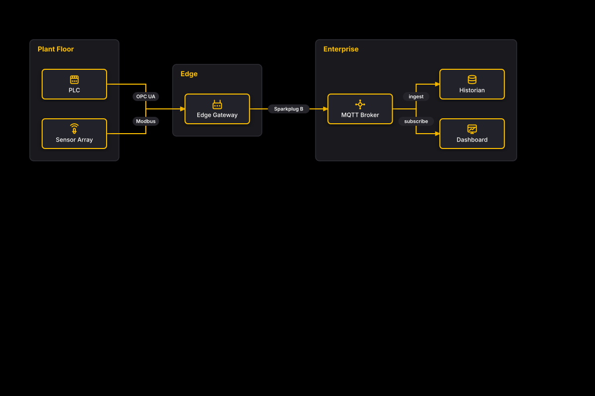

# Auto-Laid-Out UNS Backbone

## Bill of Materials

| Symbol / ID | Label | Kind | Group | Technical Notes / Metadata |
| :--- | :--- | :--- | :--- | :--- |
| `shape_2` | **PLC** | box | Plant Floor | - |
| `shape_3` | **Sensor Array** | box | Plant Floor | - |
| `shape_5` | **Edge Gateway** | box | Edge | - |
| `shape_7` | **MQTT Broker** | box | Enterprise | - |
| `shape_8` | **Historian** | box | Enterprise | - |
| `shape_9` | **Dashboard** | box | Enterprise | - |

## Connections

| Source | Target | Protocol / Label | Style | Routing |
| :--- | :--- | :--- | :--- | :--- |
| **PLC** (`shape_2`) | **Edge Gateway** (`shape_5`) | OPC UA | solid | orthogonal |
| **Sensor Array** (`shape_3`) | **Edge Gateway** (`shape_5`) | Modbus | solid | orthogonal |
| **Edge Gateway** (`shape_5`) | **MQTT Broker** (`shape_7`) | Sparkplug B | solid | orthogonal |
| **MQTT Broker** (`shape_7`) | **Historian** (`shape_8`) | ingest | solid | orthogonal |
| **MQTT Broker** (`shape_7`) | **Dashboard** (`shape_9`) | subscribe | solid | orthogonal |
