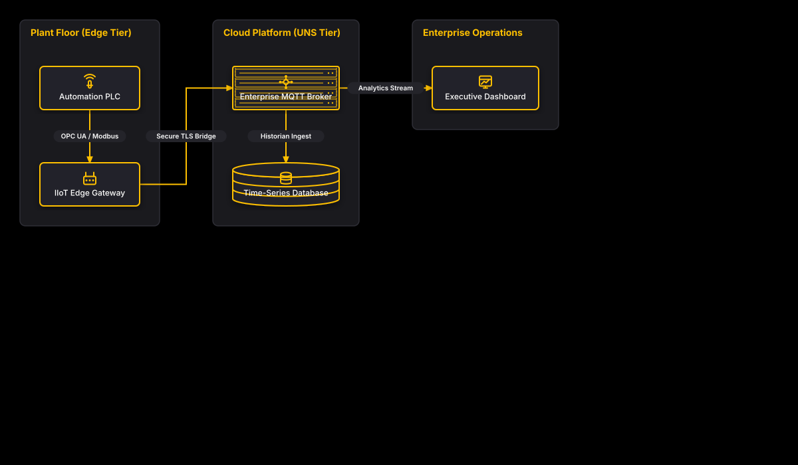

# IIoT Reference Architecture

## Bill of Materials

| Symbol / ID | Label | Kind | Group | Technical Notes / Metadata |
| :--- | :--- | :--- | :--- | :--- |
| `shape_2` | **Automation PLC** | box | Plant Floor (Edge Tier) | vendor: Siemens S7-1500, protocol: OPC UA |
| `shape_3` | **IIoT Edge Gateway** | box | Plant Floor (Edge Tier) | software: Node-RED / Ignition Edge, specs: 4-Core IPC |
| `shape_5` | **Enterprise MQTT Broker** | server_rack | Cloud Platform (UNS Tier) | engine: Enterprise MQTT Broker Cluster, ha: 3-Node Multi-AZ |
| `shape_6` | **Time-Series Database** | database | Cloud Platform (UNS Tier) | engine: InfluxDB Enterprise, retention: 365 Days |
| `shape_8` | **Executive Dashboard** | box | Enterprise Operations | platform: Grafana Enterprise, kpis: OEE / MTBF / Scada |

## Connections

| Source | Target | Protocol / Label | Style | Routing |
| :--- | :--- | :--- | :--- | :--- |
| **Automation PLC** (`shape_2`) | **IIoT Edge Gateway** (`shape_3`) | OPC UA / Modbus | solid | orthogonal |
| **Enterprise MQTT Broker** (`shape_5`) | **Time-Series Database** (`shape_6`) | Historian Ingest | solid | orthogonal |
| **IIoT Edge Gateway** (`shape_3`) | **Enterprise MQTT Broker** (`shape_5`) | Secure TLS Bridge | solid | orthogonal |
| **Enterprise MQTT Broker** (`shape_5`) | **Executive Dashboard** (`shape_8`) | Analytics Stream | solid | orthogonal |
