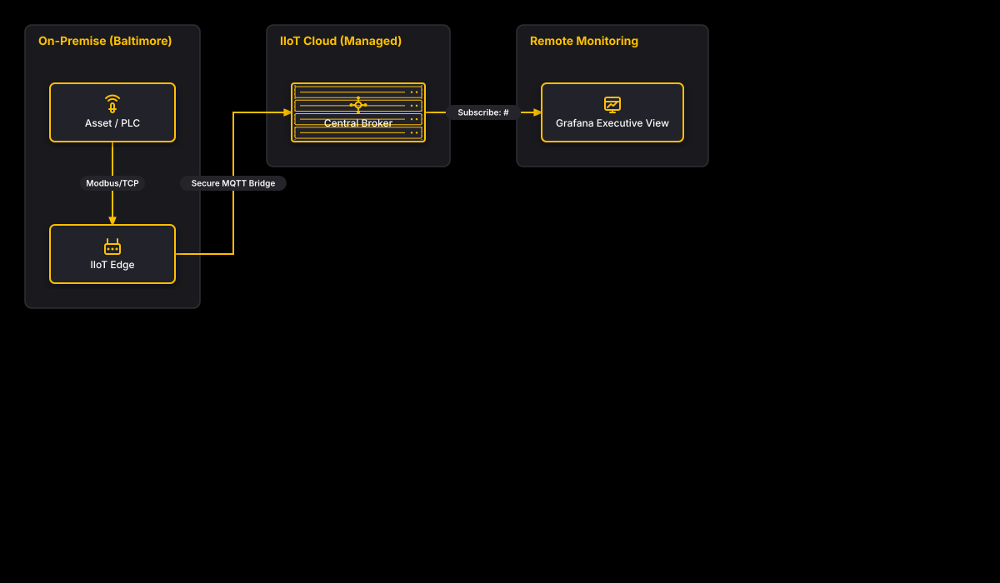

# IIoT Client Reference UNS

## Bill of Materials

| Symbol / ID | Label | Kind | Group | Technical Notes / Metadata |
| :--- | :--- | :--- | :--- | :--- |
| `shape_2` | **Asset / PLC** | box | On-Premise (Baltimore) | equipment: Allen-Bradley PLC, protocol: OPC UA / Modbus, layer: Physical Automation |
| `shape_3` | **IIoT Edge** | box | On-Premise (Baltimore) | role: Edge Gateway, software: Edge MQTT Publisher, layer: Edge Processing |
| `shape_5` | **Central Broker** | server_rack | IIoT Cloud (Managed) | service: Enterprise UNS Broker, provider: Managed Cloud, qos: QoS 1 TLS |
| `shape_7` | **Grafana Executive View** | box | Remote Monitoring | app: Grafana Cloud, audience: Operations & Executives |

## Connections

| Source | Target | Protocol / Label | Style | Routing |
| :--- | :--- | :--- | :--- | :--- |
| **Asset / PLC** (`shape_2`) | **IIoT Edge** (`shape_3`) | Modbus/TCP | solid | orthogonal |
| **IIoT Edge** (`shape_3`) | **Central Broker** (`shape_5`) | Secure MQTT Bridge | solid | orthogonal |
| **Central Broker** (`shape_5`) | **Grafana Executive View** (`shape_7`) | Subscribe: # | solid | orthogonal |
