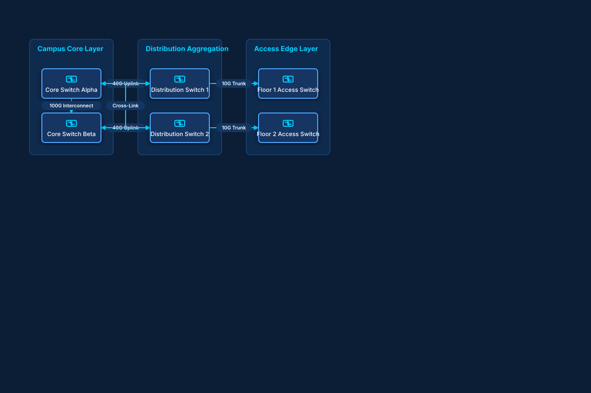

# Three-Tier Hierarchical Campus LAN

## Bill of Materials

| Symbol / ID | Label | Kind | Group | Technical Notes / Metadata |
| :--- | :--- | :--- | :--- | :--- |
| `core1` | **Core Switch Alpha** | box | Campus Core Layer | model: Catalyst 9600 |
| `core2` | **Core Switch Beta** | box | Campus Core Layer | model: Catalyst 9600 |
| `dist1` | **Distribution Switch 1** | box | Distribution Aggregation | routing: OSPF / HSRP |
| `dist2` | **Distribution Switch 2** | box | Distribution Aggregation | routing: OSPF / HSRP |
| `acc1` | **Floor 1 Access Switch** | box | Access Edge Layer | poe: 802.3bt PoE++ |
| `acc2` | **Floor 2 Access Switch** | box | Access Edge Layer | poe: 802.3bt PoE++ |

## Connections

| Source | Target | Protocol / Label | Style | Routing |
| :--- | :--- | :--- | :--- | :--- |
| **Core Switch Alpha** (`core1`) | **Core Switch Beta** (`core2`) | 100G Interconnect | solid | orthogonal |
| **Core Switch Alpha** (`core1`) | **Distribution Switch 1** (`dist1`) | 40G Uplink | solid | orthogonal |
| **Core Switch Beta** (`core2`) | **Distribution Switch 2** (`dist2`) | 40G Uplink | solid | orthogonal |
| **Distribution Switch 1** (`dist1`) | **Core Switch Beta** (`core2`) | Cross-Link | solid | orthogonal |
| **Distribution Switch 2** (`dist2`) | **Core Switch Alpha** (`core1`) | Cross-Link | solid | orthogonal |
| **Distribution Switch 1** (`dist1`) | **Floor 1 Access Switch** (`acc1`) | 10G Trunk | solid | orthogonal |
| **Distribution Switch 2** (`dist2`) | **Floor 2 Access Switch** (`acc2`) | 10G Trunk | solid | orthogonal |
