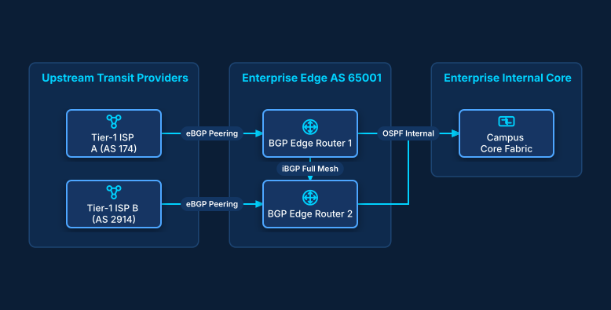

# Dual-Homed eBGP Enterprise WAN Peering

## Bill of Materials

| Symbol / ID | Label | Kind | Group | Technical Notes / Metadata |
| :--- | :--- | :--- | :--- | :--- |
| `isp1` | **Tier-1 ISP A (AS 174)** | box | Upstream Transit Providers | routes: Full BGP Table |
| `isp2` | **Tier-1 ISP B (AS 2914)** | box | Upstream Transit Providers | routes: Full BGP Table |
| `edge1` | **BGP Edge Router 1** | box | Enterprise Edge AS 65001 | hardware: Juniper MX204 |
| `edge2` | **BGP Edge Router 2** | box | Enterprise Edge AS 65001 | hardware: Juniper MX204 |
| `core_fabric` | **Campus Core Fabric** | box | Enterprise Internal Core | backbone: ECMP Routing |

## Connections

| Source | Target | Protocol / Label | Style | Routing |
| :--- | :--- | :--- | :--- | :--- |
| **Tier-1 ISP A (AS 174)** (`isp1`) | **BGP Edge Router 1** (`edge1`) | eBGP Peering | solid | orthogonal |
| **Tier-1 ISP B (AS 2914)** (`isp2`) | **BGP Edge Router 2** (`edge2`) | eBGP Peering | solid | orthogonal |
| **BGP Edge Router 1** (`edge1`) | **BGP Edge Router 2** (`edge2`) | iBGP Full Mesh | solid | orthogonal |
| **BGP Edge Router 1** (`edge1`) | **Campus Core Fabric** (`core_fabric`) | OSPF Internal | solid | orthogonal |
| **BGP Edge Router 2** (`edge2`) | **Campus Core Fabric** (`core_fabric`) | OSPF Internal | solid | orthogonal |
