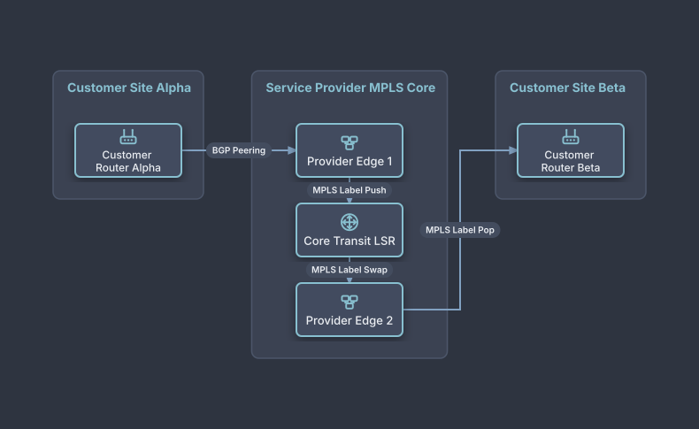

# MPLS Layer 3 VPN Service Provider Backbone

## Bill of Materials

| Symbol / ID | Label | Kind | Group | Technical Notes / Metadata |
| :--- | :--- | :--- | :--- | :--- |
| `ce1` | **Customer Router Alpha** | box | Customer Site Alpha | vrf: VRF-Finance |
| `pe1` | **Provider Edge 1** | box | Service Provider MPLS Core | labels: LDP / RSVP-TE |
| `p_core` | **Core Transit LSR** | box | Service Provider MPLS Core | speed: 400Gbps Backbone |
| `pe2` | **Provider Edge 2** | box | Service Provider MPLS Core | labels: MP-BGP VPNv4 |
| `ce2` | **Customer Router Beta** | box | Customer Site Beta | vrf: VRF-Finance |

## Connections

| Source | Target | Protocol / Label | Style | Routing |
| :--- | :--- | :--- | :--- | :--- |
| **Customer Router Alpha** (`ce1`) | **Provider Edge 1** (`pe1`) | BGP Peering | solid | orthogonal |
| **Provider Edge 1** (`pe1`) | **Core Transit LSR** (`p_core`) | MPLS Label Push | solid | orthogonal |
| **Core Transit LSR** (`p_core`) | **Provider Edge 2** (`pe2`) | MPLS Label Swap | solid | orthogonal |
| **Provider Edge 2** (`pe2`) | **Customer Router Beta** (`ce2`) | MPLS Label Pop | solid | orthogonal |
