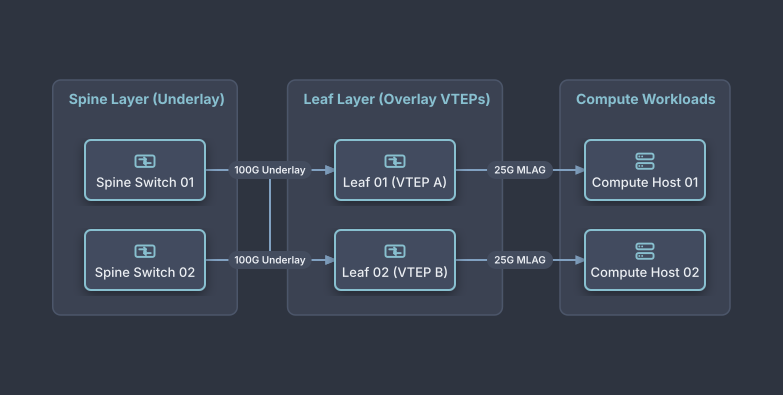

# EVPN-VXLAN Datacenter Spine-Leaf Fabric

## Bill of Materials

| Symbol / ID | Label | Kind | Group | Technical Notes / Metadata |
| :--- | :--- | :--- | :--- | :--- |
| `spine1` | **Spine Switch 01** | box | Spine Layer (Underlay) | speed: 400GbE QSFP-DD |
| `spine2` | **Spine Switch 02** | box | Spine Layer (Underlay) | speed: 400GbE QSFP-DD |
| `leaf1` | **Leaf 01 (VTEP A)** | box | Leaf Layer (Overlay VTEPs) | vni: VXLAN 10010 |
| `leaf2` | **Leaf 02 (VTEP B)** | box | Leaf Layer (Overlay VTEPs) | vni: VXLAN 10020 |
| `host1` | **Compute Host 01** | box | Compute Workloads | lacp: Bond0 Active/Active |
| `host2` | **Compute Host 02** | box | Compute Workloads | lacp: Bond0 Active/Active |

## Connections

| Source | Target | Protocol / Label | Style | Routing |
| :--- | :--- | :--- | :--- | :--- |
| **Spine Switch 01** (`spine1`) | **Leaf 01 (VTEP A)** (`leaf1`) | 100G Underlay | solid | orthogonal |
| **Spine Switch 01** (`spine1`) | **Leaf 02 (VTEP B)** (`leaf2`) | 100G Underlay | solid | orthogonal |
| **Spine Switch 02** (`spine2`) | **Leaf 01 (VTEP A)** (`leaf1`) | 100G Underlay | solid | orthogonal |
| **Spine Switch 02** (`spine2`) | **Leaf 02 (VTEP B)** (`leaf2`) | 100G Underlay | solid | orthogonal |
| **Leaf 01 (VTEP A)** (`leaf1`) | **Compute Host 01** (`host1`) | 25G MLAG | solid | orthogonal |
| **Leaf 02 (VTEP B)** (`leaf2`) | **Compute Host 02** (`host2`) | 25G MLAG | solid | orthogonal |
