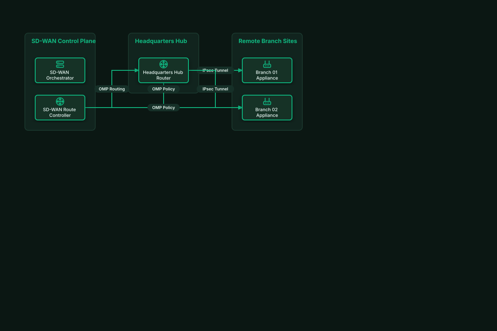

# Enterprise SD-WAN Hub-and-Spoke Topology

## Bill of Materials

| Symbol / ID | Label | Kind | Group | Technical Notes / Metadata |
| :--- | :--- | :--- | :--- | :--- |
| `vmanage` | **SD-WAN Orchestrator** | box | SD-WAN Control Plane | role: vManage NMS |
| `vsmart` | **SD-WAN Route Controller** | box | SD-WAN Control Plane | protocol: OMP Policy |
| `hub` | **Headquarters Hub Router** | box | Headquarters Hub | throughput: 10 Gbps IPsec |
| `branch1` | **Branch 01 Appliance** | box | Remote Branch Sites | uplink: Broadband + LTE |
| `branch2` | **Branch 02 Appliance** | box | Remote Branch Sites | uplink: Dual Fiber Broadband |

## Connections

| Source | Target | Protocol / Label | Style | Routing |
| :--- | :--- | :--- | :--- | :--- |
| **SD-WAN Route Controller** (`vsmart`) | **Headquarters Hub Router** (`hub`) | OMP Routing | solid | orthogonal |
| **SD-WAN Route Controller** (`vsmart`) | **Branch 01 Appliance** (`branch1`) | OMP Policy | solid | orthogonal |
| **SD-WAN Route Controller** (`vsmart`) | **Branch 02 Appliance** (`branch2`) | OMP Policy | solid | orthogonal |
| **Headquarters Hub Router** (`hub`) | **Branch 01 Appliance** (`branch1`) | IPsec Tunnel | solid | orthogonal |
| **Headquarters Hub Router** (`hub`) | **Branch 02 Appliance** (`branch2`) | IPsec Tunnel | solid | orthogonal |
