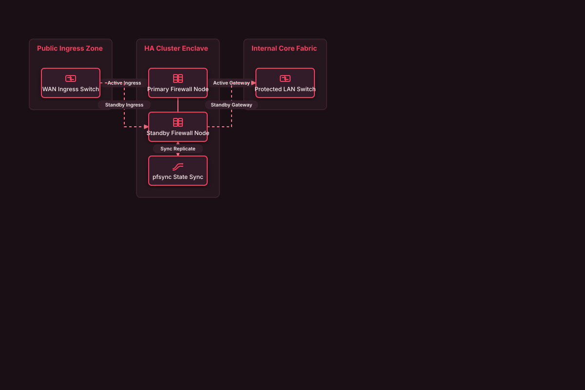

# High-Availability Active/Passive Firewall Cluster

## Bill of Materials

| Symbol / ID | Label | Kind | Group | Technical Notes / Metadata |
| :--- | :--- | :--- | :--- | :--- |
| `wan_sw` | **WAN Ingress Switch** | box | Public Ingress Zone | vip: 198.51.100.1 VIP |
| `fw_pri` | **Primary Firewall Node** | box | HA Cluster Enclave | role: MASTER (advbase=1) |
| `fw_sec` | **Standby Firewall Node** | box | HA Cluster Enclave | role: BACKUP (advskew=100) |
| `sync_link` | **pfsync State Sync** | box | HA Cluster Enclave | speed: Dedicated 10GbE |
| `lan_sw` | **Protected LAN Switch** | box | Internal Core Fabric | gateway: 10.0.0.1 VIP |

## Connections

| Source | Target | Protocol / Label | Style | Routing |
| :--- | :--- | :--- | :--- | :--- |
| **WAN Ingress Switch** (`wan_sw`) | **Primary Firewall Node** (`fw_pri`) | Active Ingress | solid | orthogonal |
| **WAN Ingress Switch** (`wan_sw`) | **Standby Firewall Node** (`fw_sec`) | Standby Ingress | dashed | orthogonal |
| **Primary Firewall Node** (`fw_pri`) | **pfsync State Sync** (`sync_link`) | Session States | solid | orthogonal |
| **pfsync State Sync** (`sync_link`) | **Standby Firewall Node** (`fw_sec`) | Sync Replicate | solid | orthogonal |
| **Primary Firewall Node** (`fw_pri`) | **Protected LAN Switch** (`lan_sw`) | Active Gateway | solid | orthogonal |
| **Standby Firewall Node** (`fw_sec`) | **Protected LAN Switch** (`lan_sw`) | Standby Gateway | dashed | orthogonal |
