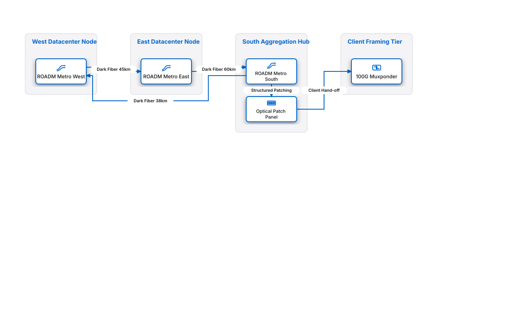

# Metro DWDM Optical Transport Ring

## Bill of Materials

| Symbol / ID | Label | Kind | Group | Technical Notes / Metadata |
| :--- | :--- | :--- | :--- | :--- |
| `roadm_w` | **ROADM Metro West** | box | West Datacenter Node | waves: 96 C-Band Channels |
| `roadm_e` | **ROADM Metro East** | box | East Datacenter Node | waves: 96 C-Band Channels |
| `roadm_s` | **ROADM Metro South** | box | South Aggregation Hub | amp: EDFA In-Line Amp |
| `patch_bay` | **Optical Patch Panel** | box | South Aggregation Hub | capacity: 144-Fiber LC/APC |
| `transponder` | **100G Muxponder** | box | Client Framing Tier | client: 10x 10GbE into 100G OTU4 |

## Connections

| Source | Target | Protocol / Label | Style | Routing |
| :--- | :--- | :--- | :--- | :--- |
| **ROADM Metro West** (`roadm_w`) | **ROADM Metro East** (`roadm_e`) | Dark Fiber 45km | solid | orthogonal |
| **ROADM Metro East** (`roadm_e`) | **ROADM Metro South** (`roadm_s`) | Dark Fiber 60km | solid | orthogonal |
| **ROADM Metro South** (`roadm_s`) | **ROADM Metro West** (`roadm_w`) | Dark Fiber 38km | solid | orthogonal |
| **ROADM Metro South** (`roadm_s`) | **Optical Patch Panel** (`patch_bay`) | Structured Patching | solid | orthogonal |
| **Optical Patch Panel** (`patch_bay`) | **100G Muxponder** (`transponder`) | Client Hand-off | solid | orthogonal |
