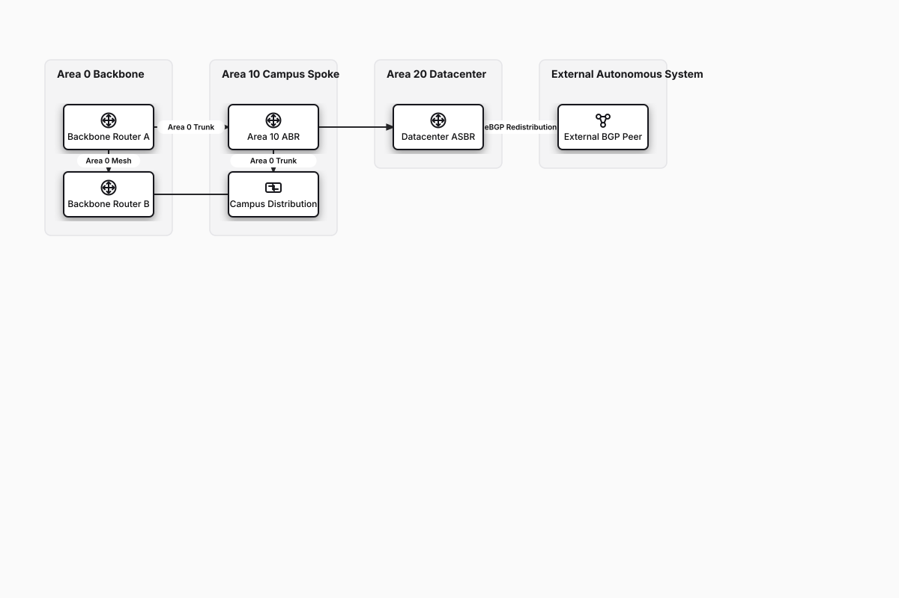

# OSPF Multi-Area Enterprise Routing

## Bill of Materials

| Symbol / ID | Label | Kind | Group | Technical Notes / Metadata |
| :--- | :--- | :--- | :--- | :--- |
| `bb_rtr1` | **Backbone Router A** | box | Area 0 Backbone | role: Backbone Router |
| `bb_rtr2` | **Backbone Router B** | box | Area 0 Backbone | role: Backbone Router |
| `abr_campus` | **Area 10 ABR** | box | Area 10 Campus Spoke | lsa: Type 3 Summary LSA |
| `campus_sw` | **Campus Distribution** | box | Area 10 Campus Spoke | area: Totally Stubby |
| `asbr_dc` | **Datacenter ASBR** | box | Area 20 Datacenter | redist: BGP External -> Type 5 LSA |
| `bgp_peer` | **External BGP Peer** | box | External Autonomous System | asn: AS 65100 |

## Connections

| Source | Target | Protocol / Label | Style | Routing |
| :--- | :--- | :--- | :--- | :--- |
| **Backbone Router A** (`bb_rtr1`) | **Backbone Router B** (`bb_rtr2`) | Area 0 Mesh | solid | orthogonal |
| **Backbone Router A** (`bb_rtr1`) | **Area 10 ABR** (`abr_campus`) | Area 0 Trunk | solid | orthogonal |
| **Area 10 ABR** (`abr_campus`) | **Campus Distribution** (`campus_sw`) | Area 10 Internal | solid | orthogonal |
| **Backbone Router B** (`bb_rtr2`) | **Datacenter ASBR** (`asbr_dc`) | Area 0 Trunk | solid | orthogonal |
| **Datacenter ASBR** (`asbr_dc`) | **External BGP Peer** (`bgp_peer`) | eBGP Redistribution | solid | orthogonal |
