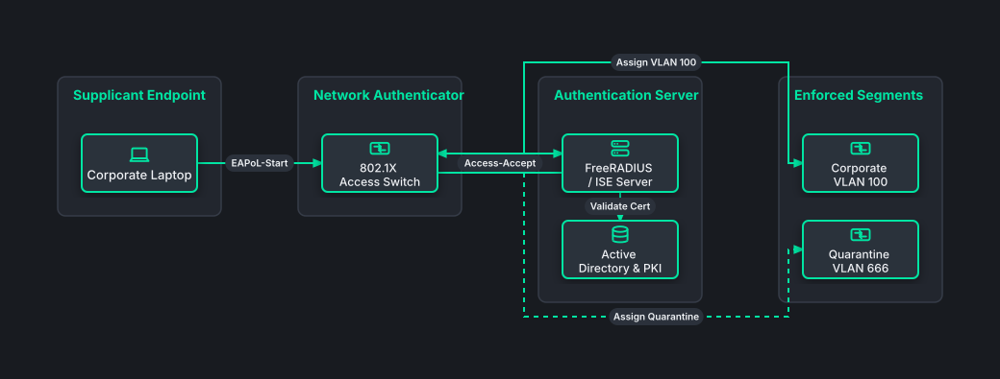

# 802.1X Network Access Control (NAC) & RADIUS

## Bill of Materials

| Symbol / ID | Label | Kind | Group | Technical Notes / Metadata |
| :--- | :--- | :--- | :--- | :--- |
| `supplicant` | **Corporate Laptop** | box | Supplicant Endpoint | auth: EAP-TLS Certificate |
| `auth_sw` | **802.1X Access Switch** | box | Network Authenticator | feature: Dynamic VLAN & ACLs |
| `radius_srv` | **FreeRADIUS / ISE Server** | box | Authentication Server | protocol: RADIUS UDP 1812 |
| `ca_ad` | **Active Directory & PKI** | box | Authentication Server | check: LDAP / CRL Verification |
| `vlan_corp` | **Corporate VLAN 100** | box | Enforced Segments | subnet: 10.100.0.0/24 |
| `vlan_iso` | **Quarantine VLAN 666** | box | Enforced Segments | policy: Remediation Only |

## Connections

| Source | Target | Protocol / Label | Style | Routing |
| :--- | :--- | :--- | :--- | :--- |
| **Corporate Laptop** (`supplicant`) | **802.1X Access Switch** (`auth_sw`) | EAPoL-Start | solid | orthogonal |
| **802.1X Access Switch** (`auth_sw`) | **FreeRADIUS / ISE Server** (`radius_srv`) | Access-Request | solid | orthogonal |
| **FreeRADIUS / ISE Server** (`radius_srv`) | **Active Directory & PKI** (`ca_ad`) | Validate Cert | solid | orthogonal |
| **FreeRADIUS / ISE Server** (`radius_srv`) | **802.1X Access Switch** (`auth_sw`) | Access-Accept | solid | orthogonal |
| **802.1X Access Switch** (`auth_sw`) | **Corporate VLAN 100** (`vlan_corp`) | Assign VLAN 100 | solid | orthogonal |
| **802.1X Access Switch** (`auth_sw`) | **Quarantine VLAN 666** (`vlan_iso`) | Assign Quarantine | dashed | orthogonal |
