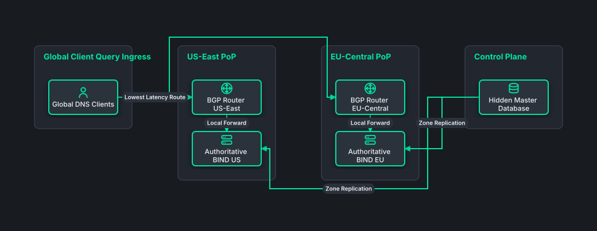

# Global Anycast Authoritative DNS Network

## Bill of Materials

| Symbol / ID | Label | Kind | Group | Technical Notes / Metadata |
| :--- | :--- | :--- | :--- | :--- |
| `client_query` | **Global DNS Clients** | box | Global Client Query Ingress | ip: Query 192.0.2.1 |
| `rtr_us` | **BGP Router US-East** | box | US-East PoP | asn: AS 64512 Anycast |
| `dns_us` | **Authoritative BIND US** | box | US-East PoP | engine: Knot / BIND9 |
| `rtr_eu` | **BGP Router EU-Central** | box | EU-Central PoP | asn: AS 64512 Anycast |
| `dns_eu` | **Authoritative BIND EU** | box | EU-Central PoP | engine: Knot / BIND9 |
| `master_db` | **Hidden Master Database** | box | Control Plane | sync: TSIG AXFR / IXFR |

## Connections

| Source | Target | Protocol / Label | Style | Routing |
| :--- | :--- | :--- | :--- | :--- |
| **Global DNS Clients** (`client_query`) | **BGP Router US-East** (`rtr_us`) | Lowest Latency Route | solid | orthogonal |
| **Global DNS Clients** (`client_query`) | **BGP Router EU-Central** (`rtr_eu`) | Lowest Latency Route | solid | orthogonal |
| **BGP Router US-East** (`rtr_us`) | **Authoritative BIND US** (`dns_us`) | Local Forward | solid | orthogonal |
| **BGP Router EU-Central** (`rtr_eu`) | **Authoritative BIND EU** (`dns_eu`) | Local Forward | solid | orthogonal |
| **Hidden Master Database** (`master_db`) | **Authoritative BIND US** (`dns_us`) | Zone Replication | solid | orthogonal |
| **Hidden Master Database** (`master_db`) | **Authoritative BIND EU** (`dns_eu`) | Zone Replication | solid | orthogonal |
